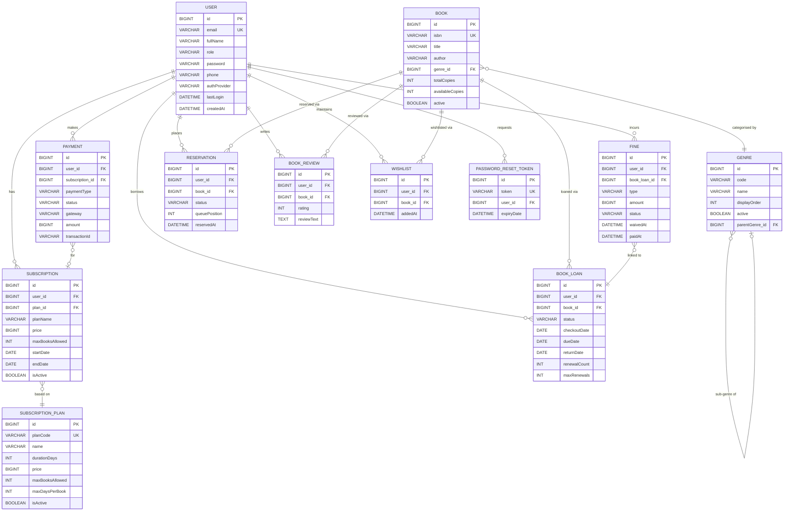
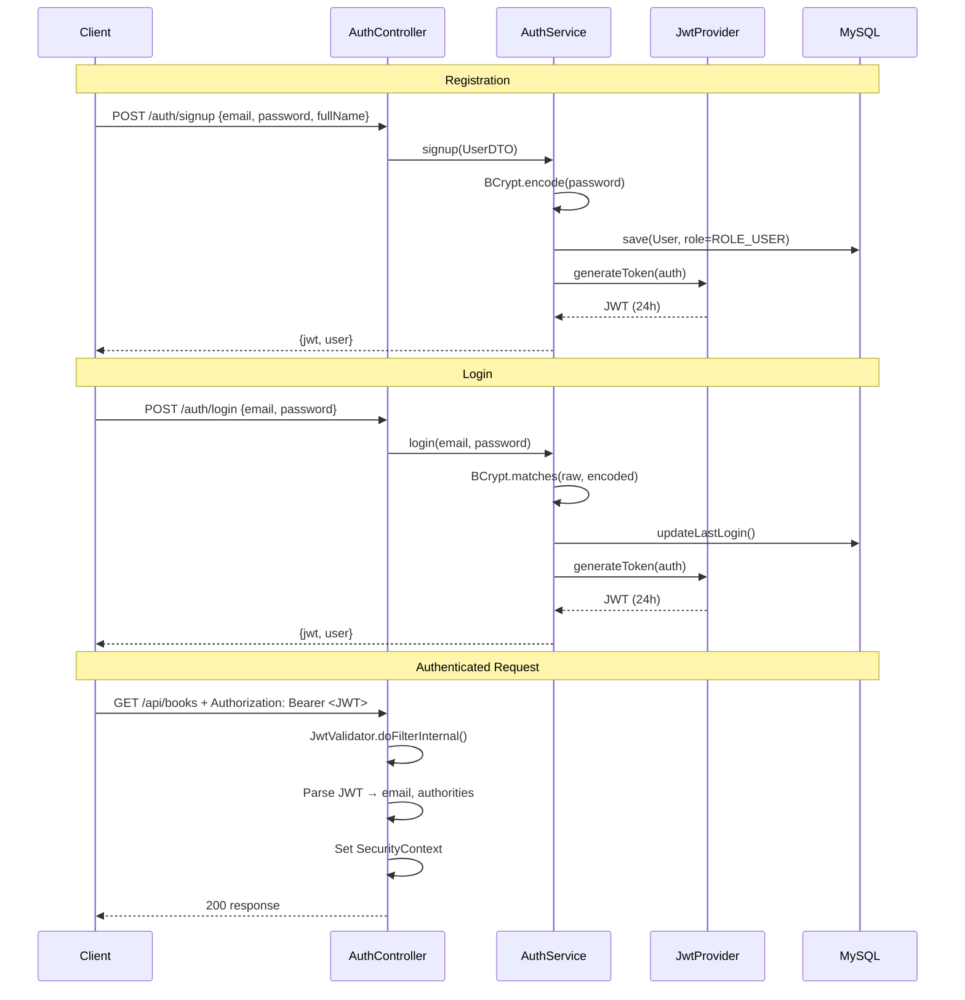
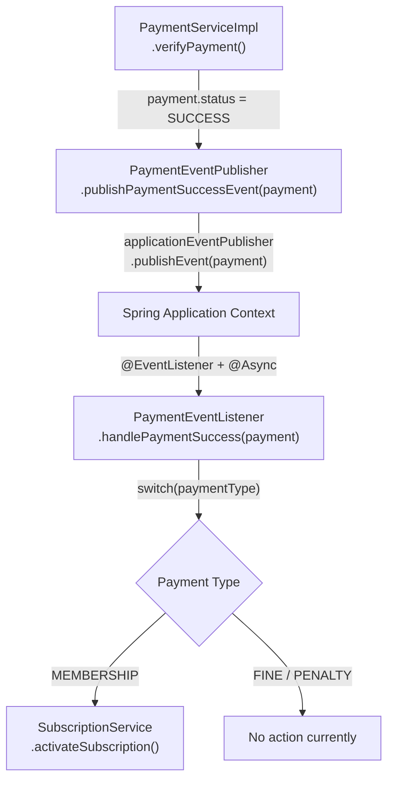

# 📚 PS Library

> **Enterprise-grade Library Management REST API** built with Java 21 and Spring Boot 4.1, featuring JWT authentication, role-based access control, book circulation, queue-based reservations, fine management, Razorpay payment integration, subscription memberships, and an event-driven post-payment workflow.

<div align="center">


</div>

---

## Table of Contents

- [Overview](#overview)
- [Problem Statement](#problem-statement)
- [Solution](#solution)
- [Key Features](#key-features)
- [Technology Stack](#technology-stack)
- [System Architecture](#system-architecture)
- [Project Structure](#project-structure)
- [Database Design](#database-design)
- [Authentication & Authorization](#authentication--authorization)
- [API Documentation](#api-documentation)
- [Payment Integration](#payment-integration)
- [Email System](#email-system)
- [Event-Driven Architecture](#event-driven-architecture)
- [Security](#security)
- [Validation & Error Handling](#validation--error-handling)
- [Business Workflows](#business-workflows)
- [Docker](#docker)
- [Environment Variables](#environment-variables)
- [Local Development](#local-development)
- [Database Setup](#database-setup)
- [Testing](#testing)
- [Project Statistics](#project-statistics)
- [Engineering Highlights](#engineering-highlights)
- [Challenges & Solutions](#challenges--solutions)
- [Future Improvements](#future-improvements)
- [Interview Value](#interview-value)
- [Author](#author)

---

## Overview

**PS Library** is a production-oriented, API-first backend system that digitises and automates the core operations of a modern library. Built with Java 21 and Spring Boot 4.1, it exposes a secure REST API that any frontend client (web, mobile) can consume to manage the full library lifecycle — from user registration through to book checkout, reservations, fine collection, and membership management.

The system enforces real business rules at the service layer: users cannot borrow more books than their subscription tier allows, they cannot checkout books while carrying overdue loans, and they can only review books they have actually returned. Every user-facing monetary transaction (fine payment, membership subscription) flows through a live **Razorpay** payment integration.

Authentication is entirely stateless, using **JWT** issued on login and validated on every request by a custom Spring Security filter. Two roles exist — `ROLE_ADMIN` (full system control) and `ROLE_USER` (member operations) — with Spring Security enforcing route-level authorization.

---

## Problem Statement

Traditional library operations are plagued by manual, error-prone processes:

- **Loan tracking** via paper registers or spreadsheets leads to lost records and disputes
- **Fine calculation** is inconsistent and often goes uncollected
- **Book reservations** have no queue management — members have no way to know when a book becomes available
- **Subscription management** is ad-hoc with no automatic enforcement of borrowing limits
- **Payments** require in-person cash transactions, causing revenue loss
- **Account recovery** requires staff intervention for password resets

---

## Solution

PS Library replaces these fragmented manual processes with a cohesive, secured REST API:

| Problem | Solution |
|---|---|
| Manual loan tracking | Automated checkout/return lifecycle with inventory management |
| Inconsistent fines | Admin-created fines with Razorpay online payment |
| No reservation queue | FIFO queue with position tracking and admin fulfillment |
| Unenforceable borrowing limits | Subscription-tier limits enforced at checkout time |
| Cash-only payments | Razorpay payment link generation (email + SMS notification) |
| Manual password reset | Secure time-limited token emailed to the user |
| No membership management | Plan-based subscription system with automatic activation post-payment |

---

## Key Features

### 🔐 Authentication & Security

- User registration with BCrypt-hashed passwords
- JWT-based stateless login (24-hour token lifetime)
- Role-based access control: `ROLE_ADMIN` and `ROLE_USER`
- Forgot password — generates a UUID token (5-minute expiry) and emails a reset link
- Reset password — validates token, encodes new password, invalidates used token
- Custom `OncePerRequestFilter` for JWT validation on every request

### 📚 Book Management

- Single and bulk book creation (admin)
- Full CRUD — get by ID, get by ISBN, update, soft delete, hard delete
- Multi-field search: title, author, ISBN, genre, availability — paginated and sorted
- Book statistics: total active books, total available copies
- Soft delete (`active = false`) preserves referential integrity
- Available copy counter automatically adjusted on checkout and return

### 🔄 Book Loans (Circulation)

- Self-checkout and admin-assisted checkout for a specific user
- 9-step checkout validation: user validity → active subscription → book availability → no duplicate loan → borrowing limit → no overdue loans
- Check-in (return) with configurable return condition (`RETURNED`, `LOST`, `DAMAGED`)
- Loan renewal (up to 2 renewals) with configurable extension days
- Overdue detection: bulk scan marks `CHECKED_OUT` loans past due date as `OVERDUE`
- Loan history: paginated, filterable by status

### ⏳ Reservations

- Queue-based book holds for fully checked-out books
- Queue position assigned automatically based on pending reservation count
- Admin fulfillment: triggers checkout for the waiting user
- Reservation cancellation (own or admin)
- Maximum 5 active reservations per user enforced
- Guards: no duplicate reservation, no reservation if book is available, no reservation if book already borrowed

### 💰 Fine Management

- Admin-created fines linked to a book loan (types: `OVERDUE`, `DAMAGE`, `LOSS`, `PROCESSING`)
- Online payment via Razorpay payment link
- Admin fine waiver with reason and full audit trail (`waivedBy`, `waivedAt`, `waiverReason`)
- Fine status machine: `PENDING → PAID` or `PENDING → WAIVED`
- User and admin fine listing with filters (status, type, user)

### 💳 Subscriptions & Memberships

- Users subscribe to a plan; a Razorpay payment link is returned immediately
- Subscription automatically activated (async, event-driven) after payment is verified
- Plan data snapshotted at subscription time (price/limits don't change retroactively)
- Subscription cancellation with reason
- Expiry management: bulk deactivation of subscriptions past their end date
- Active subscription lookup used to enforce checkout limits

### 📋 Subscription Plans (Admin)

- Admin-managed pricing tiers: plan code, name, price (INR), duration, max books allowed, max days per book
- Featured flag, badge text, display order, admin notes
- Full CRUD via admin-protected endpoints

### 💸 Payments (Razorpay)

- Payment link creation with customer pre-fill (name, email, phone), amount in paisa, callback URL, and embedded metadata notes
- Razorpay sends email and SMS notification to the customer on link creation
- Payment verification: fetches payment from Razorpay API, validates `captured` status and amount
- Supports payment types: `FINE`, `MEMBERSHIP`, `LOST_BOOK_PENALTY`, `DAMAGED_BOOK_PENALTY`
- Internal transaction ID (`TXN_...` UUID) and Razorpay `payment_link_id` both persisted

### ⭐ Reviews

- Users can only review books they have a `RETURNED` loan for (verified borrower enforcement)
- One review per user per book
- Rating 1–5, review text 10–2000 characters, optional title
- Create, update, delete own reviews; paginated reviews per book

### 📌 Wishlist

- Personal reading list with optional notes per entry
- Add, remove, and paginated listing
- Duplicate guard: cannot add the same book twice

### 📧 Email (SMTP)

- HTML-capable MIME email via Spring Mail and Gmail SMTP
- Password reset email with time-limited (5-minute) link pointing to the configured frontend URL
- SMTP connection, read, and write timeouts configured (5000 ms each)

### 👑 Admin Features

- Book and genre management (create, update, soft/hard delete)
- Admin checkout on behalf of any user
- Admin reservation management (create, cancel, fulfill)
- Fine creation, waiver, and admin listing
- Subscription plan management
- All-user fine and loan overview with filters
- Overdue bulk update trigger

---

## Technology Stack

### Backend

| Technology | Version | Purpose |
|---|---|---|
| Java | 21 (LTS) | Core language |
| Spring Boot | 4.1.0 | Application framework & auto-configuration |
| Spring Web MVC | 4.1.0 | REST controllers, request mapping |
| Spring Data JPA | 4.1.0 | Repository abstraction over Hibernate |
| Hibernate | (via JPA) | ORM, JPQL query execution |
| Spring Security | 4.1.0 | Authentication filter chain, route authorization |
| Spring Mail | 4.1.0 | SMTP email (JavaMailSender, MimeMessage) |
| Spring DevTools | 4.1.0 | Hot reload during development |
| JJWT | 0.12.6 | JWT generation and validation |
| Razorpay Java SDK | 1.4.9 | Payment link creation and verification |
| Lombok | latest | Boilerplate reduction (`@Builder`, `@Data`, `@RequiredArgsConstructor`) |
| Jakarta Bean Validation | (via Spring) | DTO validation annotations |
| Maven | 3.x | Build and dependency management |

### Database

| Technology | Purpose |
|---|---|
| MySQL 8.x | Relational database |
| MySQL Connector/J | JDBC driver |

### DevOps

| Technology | Purpose |
|---|---|
| Docker | Multi-stage containerisation (JDK build → JRE runtime) |
| Eclipse Temurin 21 | Base Docker image (JDK for build, JRE for runtime) |

---

## System Architecture

PS Library follows a strict **5-layer N-Tier architecture**. Each layer has a single responsibility and depends only on the layer directly below it.

```
┌─────────────────────────────────────┐
│         Client (Frontend)           │
│        http://localhost:5173        │
└──────────────┬──────────────────────┘
               │ HTTP + Authorization: Bearer <JWT>
               ▼
┌─────────────────────────────────────┐
│        JwtValidator Filter          │  OncePerRequestFilter
│  Extract JWT → Set SecurityContext  │  Runs before every /api/** request
└──────────────┬──────────────────────┘
               │
               ▼
┌─────────────────────────────────────┐
│       Spring Security Chain         │  Role-based route authorization
│  /api/admin/**  → ROLE_ADMIN only   │  CORS policy
│  /api/**        → Authenticated     │
└──────────────┬──────────────────────┘
               │
               ▼
┌─────────────────────────────────────┐
│          Controller Layer           │  14 @RestController classes
│  Receives request, triggers @Valid  │  Delegates to service layer
└──────────────┬──────────────────────┘
               │
               ▼
┌─────────────────────────────────────┐
│           Service Layer             │  All business rule enforcement
│  AuthService │ BookLoanService      │  Cross-entity coordination
│  FineService │ ReservationService   │  DTO ↔ Entity via Mappers
│  SubscriptionService │ ...          │
└──────────────┬──────────────────────┘
               │
               ▼
┌─────────────────────────────────────┐
│         Repository Layer            │  12 JpaRepository interfaces
│  Custom JPQL queries with           │  Spring Data pagination
│  @Param named parameters            │
└──────────────┬──────────────────────┘
               │
               ▼
┌─────────────────────────────────────┐
│          MySQL Database             │
│             (lms)                   │
└─────────────────────────────────────┘
```

### External Integrations

```
Service Layer
    ├── RazorpayService (gateway) ──────► Razorpay API
    └── EmailService ───────────────────► Gmail SMTP
```

### Event-Driven Component

```
PaymentService ──publishEvent()──► PaymentEventPublisher
                                          │
                                    [Spring ApplicationEvent]
                                          │ @Async
                                          ▼
                              PaymentEventListener
                                          │
                              switch(paymentType == MEMBERSHIP)
                                          │
                                          ▼
                              SubscriptionService.activateSubscription()
```

---

## Project Structure

```text
library-management-system/
├── Dockerfile                          # Multi-stage Docker build
├── pom.xml                             # Maven dependencies & plugins
├── .env                                # Local environment variables (gitignored)
├── .env.example                        # Environment variable template
├── mvnw / mvnw.cmd                     # Maven wrapper scripts
│
└── src/
    └── main/
        ├── java/dev/pranavsharma/librarymanagementsystem/
        │   │
        │   ├── LibraryManagementSystemApplication.java   ← Entry point (@SpringBootApplication, @EnableAsync)
        │   │
        │   ├── configuration/                            ← Security & JWT infrastructure
        │   │   ├── JwtConstant.java                      ← JWT header name and HMAC secret
        │   │   ├── JwtProvider.java                      ← JWT generation service
        │   │   ├── JwtValidator.java                     ← OncePerRequestFilter for JWT validation
        │   │   └── SecurityConfig.java                   ← SecurityFilterChain, CORS, BCryptPasswordEncoder
        │   │
        │   ├── controller/                               ← 14 REST controllers
        │   │   ├── AdminBookController.java              ← POST /api/admin/books
        │   │   ├── AuthController.java                   ← /auth/**
        │   │   ├── BookController.java                   ← /api/books/**
        │   │   ├── BookLoanController.java               ← /api/book-loans/**
        │   │   ├── BookReviewController.java             ← /api/reviews/**
        │   │   ├── FineController.java                   ← /api/fines/**
        │   │   ├── GenreController.java                  ← /api/genres/**
        │   │   ├── HomeController.java                   ← GET /
        │   │   ├── PaymentController.java                ← /api/payments/**
        │   │   ├── ReservationController.java            ← /api/reservations/**
        │   │   ├── SubscriptionController.java           ← /api/subscriptions/**
        │   │   ├── SubscriptionPlanController.java       ← /api/subscription-plans/**
        │   │   ├── UserController.java                   ← /api/users/**
        │   │   └── WishlistController.java               ← /api/wishlist/**
        │   │
        │   ├── domain/                                   ← 10 Enum types
        │   │   ├── AuthProvider.java                     ← LOCAL, GOOGLE
        │   │   ├── BookLoanStatus.java                   ← CHECKED_OUT, RETURNED, OVERDUE, LOST, DAMAGED
        │   │   ├── BookLoanType.java                     ← CHECKOUT, RENEWAL, RETURN
        │   │   ├── FineStatus.java                       ← PENDING, PARTIALLY_PAID, PAID, WAIVED
        │   │   ├── FineType.java                         ← OVERDUE, DAMAGE, LOSS, PROCESSING
        │   │   ├── PaymentGateway.java                   ← RAZORPAY, STRIPE
        │   │   ├── PaymentStatus.java                    ← PENDING, SUCCESS, FAILED, CANCELLED, REFUNDED, PROCESSING
        │   │   ├── PaymentType.java                      ← FINE, MEMBERSHIP, LOST_BOOK_PENALTY, DAMAGED_BOOK_PENALTY, REFUND
        │   │   ├── ReservationStatus.java                ← PENDING, AVAILABLE, FULFILLED, CANCELLED, EXPIRED
        │   │   └── UserRole.java                         ← ROLE_USER, ROLE_ADMIN
        │   │
        │   ├── event/
        │   │   ├── publisher/PaymentEventPublisher.java  ← Wraps ApplicationEventPublisher
        │   │   └── listener/PaymentEventListener.java    ← @Async @EventListener → activates subscription
        │   │
        │   ├── exception/                                ← Custom exceptions + @RestControllerAdvice
        │   │   ├── BookException.java
        │   │   ├── GenreException.java
        │   │   ├── GlobalException.java                  ← Handles GenreException → 400 Bad Request
        │   │   ├── SubscriptionException.java
        │   │   └── UserException.java
        │   │
        │   ├── mapper/                                   ← 11 manual DTO ↔ Entity converters
        │   │
        │   ├── model/                                    ← 12 JPA entities (@Entity)
        │   │   ├── Book.java
        │   │   ├── BookLoan.java
        │   │   ├── BookReview.java
        │   │   ├── Fine.java
        │   │   ├── Genre.java
        │   │   ├── PasswordResetToken.java
        │   │   ├── Payment.java
        │   │   ├── Reservation.java
        │   │   ├── Subscription.java
        │   │   ├── SubscriptionPlan.java
        │   │   ├── User.java
        │   │   └── Wishlist.java
        │   │
        │   ├── payload/
        │   │   ├── dto/                                  ← 11 Data Transfer Objects
        │   │   ├── request/                              ← 16 request payload classes
        │   │   └── response/                             ← ApiResponse, AuthResponse, PageResponse<T>, PaymentInitiateResponse, PaymentLinkResponse
        │   │
        │   ├── repository/                               ← 12 JpaRepository interfaces
        │   │
        │   └── service/
        │       ├── (13 service interfaces)
        │       ├── gateway/RazorpayService.java          ← Razorpay SDK integration
        │       └── impl/                                 ← 15 service implementations
        │           └── DataInitializationComponent.java  ← CommandLineRunner — seeds admin user on startup
        │
        └── resources/
            └── application.properties                   ← All configuration (env-var driven)
```

---

## Database Design

Hibernate auto-creates and updates the schema based on JPA entity definitions (`ddl-auto=update`).

### Entities & Relationships



### Key Design Decisions

- **Soft delete** on `Book` and `Genre` (`active = false`) preserves referential integrity across loans, reviews, and wishlists
- **Plan snapshotting** on `Subscription` — `planName`, `price`, `maxBooksAllowed`, `maxDaysPerBook` are copied at subscription time so plan changes don't affect existing subscribers
- **Self-referential `Genre`** — `parentGenre` FK enables unlimited-depth genre hierarchies (e.g. Fiction → Sci-Fi → Space Opera)
- **Audit fields** on `Fine` — `waivedBy`, `waivedAt`, `waiverReason`, `paidAt`, `transactionId` provide a complete audit trail

---

## Authentication & Authorization

### Flow



### JWT Details

| Property | Value |
|---|---|
| Algorithm | HMAC-SHA |
| Lifetime | 24 hours (86,400,000 ms) |
| Header | `Authorization: Bearer <token>` |
| Claims | `email`, `authorities`, `iat`, `exp` |
| Filter | `JwtValidator extends OncePerRequestFilter` |

### Authorization Rules

| Pattern | Access |
|---|---|
| `/auth/**` | Public (no token required) |
| `/` | Public |
| `/api/admin/**` | `ROLE_ADMIN` only |
| `/api/subscription-plans/admin/**` | `ROLE_ADMIN` only |
| `/api/**` | Any authenticated user |

### Password Reset Flow

```
POST /auth/forgot-password {email}
        ↓
Generate UUID token (expires in 5 minutes)
        ↓
Save PasswordResetToken to DB
        ↓
Send reset link via Gmail SMTP to user's email
        ↓
POST /auth/reset-password {token, newPassword}
        ↓
Validate token exists & not expired
        ↓
BCrypt-encode new password → update User
        ↓
Delete used token from DB
```

---

## API Documentation

All `/api/**` endpoints require: `Authorization: Bearer <JWT_TOKEN>`

### Authentication

| Method | Endpoint | Description | Auth |
|---|---|---|---|
| `POST` | `/auth/signup` | Register new user | Public |
| `POST` | `/auth/login` | Login, receive JWT | Public |
| `POST` | `/auth/forgot-password` | Send password reset email | Public |
| `POST` | `/auth/reset-password` | Reset password with token | Public |

### Books

| Method | Endpoint | Description | Auth |
|---|---|---|---|
| `POST` | `/api/admin/books` | Create a book | ROLE_ADMIN |
| `GET` | `/api/books/{id}` | Get book by ID | Authenticated |
| `GET` | `/api/books/isbn/{isbn}` | Get book by ISBN | Authenticated |
| `PUT` | `/api/books/{id}` | Update book | Authenticated |
| `DELETE` | `/api/books/{id}` | Soft delete book | Authenticated |
| `DELETE` | `/api/books/{id}/permanent` | Hard delete book | Authenticated |
| `POST` | `/api/books/search` | Advanced search with filters | Authenticated |
| `POST` | `/api/books/bulk` | Bulk create books | Authenticated |
| `GET` | `/api/books/stats` | Total & available book counts | Authenticated |

### Genres

| Method | Endpoint | Description | Auth |
|---|---|---|---|
| `POST` | `/api/genres/create` | Create genre | Authenticated |
| `GET` | `/api/genres` | List all active genres | Authenticated |
| `GET` | `/api/genres/{id}` | Get genre by ID | Authenticated |
| `PUT` | `/api/genres/{id}` | Update genre | Authenticated |
| `DELETE` | `/api/genres/{id}` | Soft delete genre | Authenticated |
| `DELETE` | `/api/genres/{id}/permanent` | Hard delete genre | Authenticated |
| `GET` | `/api/genres/top-level` | Get root-level genres | Authenticated |
| `GET` | `/api/genres/count` | Count active genres | Authenticated |
| `GET` | `/api/genres/{id}/book-count` | Book count in a genre | Authenticated |

### Book Loans

| Method | Endpoint | Description | Auth |
|---|---|---|---|
| `POST` | `/api/book-loans/checkout` | Self-checkout | Authenticated |
| `POST` | `/api/book-loans/checkout/user/{userId}` | Admin checkout for user | Authenticated |
| `POST` | `/api/book-loans/checkin` | Return a book | Authenticated |
| `POST` | `/api/book-loans/renew` | Renew a loan | Authenticated |
| `GET` | `/api/book-loans/my` | My loans (filterable, paginated) | Authenticated |
| `POST` | `/api/book-loans/search` | Search all loans (admin) | Authenticated |
| `POST` | `/api/book-loans/admin/update-overdue` | Bulk-mark overdue loans | Authenticated |

### Reservations

| Method | Endpoint | Description | Auth |
|---|---|---|---|
| `POST` | `/api/reservations` | Reserve a book (self) | Authenticated |
| `POST` | `/api/reservations/user/{userId}` | Reserve for user (admin) | Authenticated |
| `DELETE` | `/api/reservations/{id}` | Cancel reservation | Authenticated |
| `POST` | `/api/reservations/{id}/fulfill` | Fulfill reservation (admin) | Authenticated |
| `GET` | `/api/reservations/my` | My reservations | Authenticated |
| `GET` | `/api/reservations` | Search all reservations (admin) | Authenticated |

### Fines

| Method | Endpoint | Description | Auth |
|---|---|---|---|
| `POST` | `/api/fines` | Create fine (admin) | Authenticated |
| `POST` | `/api/fines/{id}/pay` | Pay fine via Razorpay | Authenticated |
| `POST` | `/api/fines/waive` | Waive fine (admin) | Authenticated |
| `GET` | `/api/fines/my` | My fines | Authenticated |
| `GET` | `/api/fines` | All fines with filters (admin) | Authenticated |

### Payments

| Method | Endpoint | Description | Auth |
|---|---|---|---|
| `POST` | `/api/payments/verify` | Verify Razorpay payment | Authenticated |
| `GET` | `/api/payments` | List all payments (admin) | Authenticated |

### Subscriptions

| Method | Endpoint | Description | Auth |
|---|---|---|---|
| `POST` | `/api/subscriptions/subscribe` | Subscribe to a plan | Authenticated |
| `GET` | `/api/subscriptions/user/active` | Get active subscription | Authenticated |
| `POST` | `/api/subscriptions/cancel/{id}` | Cancel subscription | Authenticated |
| `POST` | `/api/subscriptions/activate` | Manually activate subscription | Authenticated |
| `GET` | `/api/subscriptions/admin` | All subscriptions (admin) | Authenticated |
| `GET` | `/api/subscriptions/admin/deactivate-expired` | Deactivate expired subscriptions | Authenticated |

### Subscription Plans

| Method | Endpoint | Description | Auth |
|---|---|---|---|
| `GET` | `/api/subscription-plans` | List all plans | Authenticated |
| `POST` | `/api/subscription-plans/admin/create` | Create plan | ROLE_ADMIN |
| `PUT` | `/api/subscription-plans/admin/{id}` | Update plan | ROLE_ADMIN |
| `DELETE` | `/api/subscription-plans/admin/{id}` | Delete plan | ROLE_ADMIN |

### Reviews

| Method | Endpoint | Description | Auth |
|---|---|---|---|
| `POST` | `/api/reviews` | Create review | Authenticated |
| `PUT` | `/api/reviews/{id}` | Update own review | Authenticated |
| `DELETE` | `/api/reviews/{reviewId}` | Delete own review | Authenticated |
| `GET` | `/api/reviews/book/{bookId}` | Get reviews for a book | Authenticated |

### Wishlist

| Method | Endpoint | Description | Auth |
|---|---|---|---|
| `POST` | `/api/wishlist/add/{bookId}` | Add book to wishlist | Authenticated |
| `DELETE` | `/api/wishlist/remove/{bookId}` | Remove from wishlist | Authenticated |
| `GET` | `/api/wishlist/my` | My wishlist (paginated) | Authenticated |

### Users

| Method | Endpoint | Description | Auth |
|---|---|---|---|
| `GET` | `/api/users/list` | List all users | Authenticated |
| `GET` | `/api/users/profile` | Current user profile | Authenticated |

---

## Payment Integration

PS Library integrates with **Razorpay** for processing online payments against fines and subscription memberships.

### How It Works

```
User action (subscribe to plan / pay a fine)
        ↓
Backend creates a Payment record (status: PENDING)
        ↓
RazorpayService.createPaymentLink()
  - Amount converted to paisa (× 100)
  - Customer name, email, phone pre-filled
  - Razorpay sends email + SMS to customer
  - Callback URL set to: {RAZORPAY_CALLBACK_BASE_URL}/payment-success/{paymentId}
  - Internal metadata embedded in Razorpay `notes` field
        ↓
Payment link URL returned to frontend
        ↓
User completes payment on Razorpay hosted page
        ↓
Frontend calls POST /api/payments/verify {razorpayPaymentId}
        ↓
Backend fetches payment from Razorpay API
  - Validates status == "captured"
  - Validates amount matches plan/fine amount
        ↓
Payment record updated (status: SUCCESS)
        ↓
PaymentEventPublisher publishes domain event
        ↓ (async)
PaymentEventListener activates subscription
```

### Supported Payment Types

| Type | Trigger |
|---|---|
| `MEMBERSHIP` | User subscribes to a plan |
| `FINE` | User pays a library fine |
| `LOST_BOOK_PENALTY` | Charged for lost book (future) |
| `DAMAGED_BOOK_PENALTY` | Charged for damaged book (future) |

### Configuration

```properties
razorpay.key.id=${RAZORPAY_KEY_ID}
razorpay.key.secret=${RAZORPAY_KEY_SECRET}
razorpay.callback.base-url=${RAZORPAY_CALLBACK_BASE_URL}
```

> ⚠️ Never commit Razorpay keys. Always use environment variables.

---

## Email System

Email is sent via **Spring Mail** using Gmail SMTP with STARTTLS.

### Configuration

```properties
spring.mail.host=smtp.gmail.com
spring.mail.port=587
spring.mail.properties.mail.smtp.auth=true
spring.mail.properties.mail.smtp.starttls.enable=true
```

### What Triggers an Email

| Event | Email Content |
|---|---|
| Forgot password | Password reset link valid for 5 minutes |

### Setting Up Gmail SMTP

1. Enable 2-Factor Authentication on your Gmail account
2. Generate an **App Password** (Google Account → Security → App Passwords)
3. Set `MAIL_USERNAME` and `MAIL_PASSWORD` in your `.env` file

> ⚠️ Never use your actual Gmail password. Use an App Password. Never commit it.

---

## Event-Driven Architecture

PS Library uses **Spring's `ApplicationEventPublisher`** to decouple payment completion from subscription activation. This avoids a circular dependency between `PaymentService` and `SubscriptionService`, and executes the activation asynchronously.



**Why events?**
- `PaymentService` and `SubscriptionService` each depend on the other's functionality — events break this cycle cleanly
- Activation runs on a separate thread (non-blocking for the HTTP response)
- Adding new post-payment behaviours (e.g. email confirmation, analytics) requires zero changes to `PaymentService`

---

## Security

### Mechanisms in Use

| Mechanism | Implementation |
|---|---|
| **Password Hashing** | `BCryptPasswordEncoder` (default 10 rounds) |
| **Authentication** | Stateless JWT via `JwtValidator` (`OncePerRequestFilter`) |
| **Authorization** | Spring Security `hasRole()` checks in `SecurityFilterChain` |
| **Session Policy** | `SessionCreationPolicy.STATELESS` — no server-side sessions |
| **CSRF** | Disabled (appropriate for stateless REST APIs) |
| **CORS** | Configured — allows `http://localhost:5173` with credentials |
| **SQL Injection** | All queries use JPQL with `@Param` named parameters |
| **Input Validation** | Jakarta Bean Validation on all DTOs (`@Valid` on controller params) |
| **Token Expiry** | Password reset tokens expire after 5 minutes |

### CORS Configuration

| Setting | Value |
|---|---|
| Allowed Origins | `http://localhost:5173/` |
| Allowed Methods | All |
| Allowed Headers | All |
| Exposed Headers | `Authorization` |
| Allow Credentials | `true` |
| Max Age | 3600 seconds |

> For production, update `allowedOrigins` to your actual frontend domain.

---

## Validation & Error Handling

### DTO Validation Rules (Selected)

**BookDTO**

| Field | Constraint |
|---|---|
| `isbn` | `@NotBlank` |
| `title` | `@NotBlank`, `@Size(1–255)` |
| `totalCopies` / `availableCopies` | `@NotNull`, `@Min(0)` |
| `pages` | `@Min(1)`, `@Max(50000)` |
| `price` | `@DecimalMin(0.0)`, `@Digits(integer=8, fraction=2)` |

**CreateReviewRequest**

| Field | Constraint |
|---|---|
| `rating` | `@Min(1)`, `@Max(5)` |
| `reviewText` | `@NotBlank`, `@Size(10–2000)` |

**CheckoutRequest**

| Field | Constraint |
|---|---|
| `bookId` | `@NotNull` |
| `checkoutDays` | `@Min(1)` |

### Entity-Level Validation

```java
// Book.java
@AssertTrue(message = "Available copies can't exceed total number of copies!")
public boolean isAvailableCopiesValid() {
    return availableCopies <= totalCopies;
}
```

### Custom Exceptions

| Exception | Used For |
|---|---|
| `BookException` | Book not found, ISBN conflict, unavailable |
| `GenreException` | Genre not found, validation failures |
| `UserException` | User not found, duplicate registration |
| `SubscriptionException` | Subscription not found, already cancelled |

### Global Exception Handler

`@RestControllerAdvice` on `GlobalException` currently handles `GenreException` and returns:

```json
{
  "message": "Genre not found!",
  "success": false
}
```

### Standard Response Wrappers

```java
// Simple action response
ApiResponse { String message, boolean success }

// Paginated list response
PageResponse<T> { List<T> content, int pageNumber, int pageSize,
                  long totalElements, int totalPages, boolean last,
                  boolean first, boolean empty }

// Auth response
AuthResponse { String jwt, String message, String title, UserDTO user }
```

---

## Business Workflows

### Book Checkout (9 Validations)

```
User requests checkout (bookId, checkoutDays)
        │
        ▼  1. User exists?
        ▼  2. User has an active subscription?
        ▼  3. Book exists?
        ▼  4. Book is active (not soft-deleted)?
        ▼  5. Book has available copies?
        ▼  6. User doesn't already have this book checked out?
        ▼  7. User's active loans < subscription.maxBooksAllowed?
        ▼  8. User has no overdue loans?
        │
        ▼
Create BookLoan (status: CHECKED_OUT, dueDate = today + checkoutDays)
Decrement book.availableCopies by 1
Return BookLoanDTO
```

### Book Return (Check-In)

```
POST /api/book-loans/checkin {bookLoanId, condition}
        │
        ▼
Validate loan is CHECKED_OUT or OVERDUE
Set returnDate = today
Set status = condition (RETURNED / LOST / DAMAGED)
If condition ≠ LOST → increment book.availableCopies
Return BookLoanDTO
```

### Reservation

```
User reserves unavailable book
        │
        ▼  Guard: no active loan on this book
        ▼  Guard: no existing reservation
        ▼  Guard: book.availableCopies == 0
        ▼  Guard: user's active reservations < 5
        │
        ▼
queuePosition = count(PENDING reservations for book) + 1
Create Reservation (status: PENDING)

[Admin] POST /api/reservations/{id}/fulfill
        ▼
Validate reservation exists and book is available
Set status = FULFILLED
Trigger checkout for reservation.user
```

### Subscription & Payment

```
User subscribes to plan
        │
        ▼
Create Subscription (isActive: false)
Snapshot plan data into subscription
Create Payment record (status: PENDING)
        │
        ▼
RazorpayService creates payment link
Return checkout URL to frontend
        │
User pays on Razorpay ──► Redirected to frontend
        │
POST /api/payments/verify {razorpayPaymentId}
        │
        ▼
Fetch payment from Razorpay API
Validate: status == "captured" AND amount matches plan price
Update Payment (status: SUCCESS)
Publish PaymentSuccessEvent (async)
        │
        ▼ [async thread]
Activate Subscription (isActive: true, set startDate/endDate)
```

---

## Docker

The project ships with a **multi-stage Dockerfile** using Eclipse Temurin images.

### Build Stages

| Stage | Base Image | Purpose |
|---|---|---|
| `build` | `eclipse-temurin:21-jdk` | Compiles source, packages JAR (tests skipped) |
| runtime | `eclipse-temurin:21-jre` | Lean runtime image — only JRE |

Dependencies are resolved in a separate `dependency:go-offline` layer, enabling Docker build cache to skip re-downloading on source-only changes.

> **Note:** The Dockerfile exposes port `8080`, while the application runs on port `5000` (configured via `PORT` env var). Pass `-p 5000:5000` and set `PORT=5000` when running.

### Build & Run

```bash
# Build the image
docker build -t ps-library:latest .

# Run the container
docker run -p 5000:5000 \
  -e PORT=5000 \
  -e MYSQL_HOST=host.docker.internal \
  -e MYSQL_PORT=3306 \
  -e MYSQL_DATABASE=lms \
  -e MYSQL_USERNAME=<your-db-user> \
  -e MYSQL_PASSWORD=<your-db-password> \
  -e FRONTEND_URL=http://localhost:5173 \
  -e MAIL_HOST=smtp.gmail.com \
  -e MAIL_PORT=587 \
  -e MAIL_USERNAME=<your-gmail> \
  -e MAIL_PASSWORD=<your-app-password> \
  -e RAZORPAY_KEY_ID=<your-razorpay-key> \
  -e RAZORPAY_KEY_SECRET=<your-razorpay-secret> \
  -e RAZORPAY_CALLBACK_BASE_URL=http://localhost:5173 \
  ps-library:latest
```

---

## Environment Variables

Copy `.env.example` to `.env` and fill in your values before starting the application.

```env
# Application
SPRING_APPLICATION_NAME=library-management-system
PORT=5000

# Database (MySQL)
MYSQL_HOST=localhost
MYSQL_PORT=3306
MYSQL_DATABASE=lms
MYSQL_USERNAME=
MYSQL_PASSWORD=

# Frontend (used in password reset emails)
FRONTEND_URL=http://localhost:5173

# Gmail SMTP (use an App Password, not your account password)
MAIL_HOST=smtp.gmail.com
MAIL_PORT=587
MAIL_USERNAME=
MAIL_PASSWORD=

# Razorpay
RAZORPAY_KEY_ID=
RAZORPAY_KEY_SECRET=
RAZORPAY_CALLBACK_BASE_URL=http://localhost:5173
```

> ⚠️ **Never commit your `.env` file.** It is listed in `.gitignore` by default.

---

## Local Development

### Prerequisites

- **JDK 21** — [Download Temurin](https://adoptium.net/)
- **Maven 3.x** (or use the included `mvnw` wrapper — no installation required)
- **MySQL 8.x** running locally on port 3306

### Setup Steps

**1. Clone the repository**

```bash
git clone <repository-url>
cd library-management-system
```

**2. Create the database**

```sql
CREATE DATABASE lms;
```

**3. Configure environment variables**

```bash
cp .env.example .env
# Edit .env with your credentials
```

**4. Build the application**

```bash
# Unix / macOS
./mvnw clean install -DskipTests

# Windows
mvnw.cmd clean install -DskipTests
```

**5. Run the application**

```bash
# Unix / macOS
./mvnw spring-boot:run

# Windows
mvnw.cmd spring-boot:run
```

**6. Verify the API**

```
GET http://localhost:5000/
→ "Welcome to PS Library"
```

The application starts on **`http://localhost:5000`** and expects a frontend at **`http://localhost:5173`**.

---

## Database Setup

Hibernate auto-creates and auto-updates the database schema on startup (`ddl-auto=update`). No manual schema migration is required for a fresh start.

On first startup, `DataInitializationComponent` (a `CommandLineRunner`) checks whether an admin user exists and creates one if not.

> For production environments, it is strongly recommended to change `ddl-auto` to `validate` or `none` and manage schema changes via a migration tool (e.g. Flyway or Liquibase).

---

## Testing

There are currently no automated test classes authored in this project. The Maven POM includes the following test-scope dependencies for future use:

- `spring-boot-starter-data-jpa-test`
- `spring-boot-starter-webmvc-test`
- `spring-security-test`

Manual API testing can be performed using any HTTP client (e.g. Postman, Hoppscotch, curl) against `http://localhost:5000`.

---

## Project Statistics

| Metric | Count |
|---|---|
| Java source files | 132 |
| Lines of Java code | ~4,867 |
| REST controllers | 14 |
| REST API endpoints | 60+ |
| Service interfaces | 13 |
| Service implementations | 15 |
| JPA entities | 12 |
| Repository interfaces | 12 |
| Mapper classes | 11 |
| DTO classes | 11 |
| Request payload classes | 16 |
| Domain enum classes | 10 |
| Custom JPQL queries | 18+ |

---

## Engineering Highlights

**Stateless, horizontally scalable API** — JWT eliminates server-side session state. Multiple application instances can run behind a load balancer without sticky sessions.

**9-step checkout validation** — `BookLoanServiceImpl.checkoutBookForUser()` sequentially enforces user validity, subscription status, book availability, duplicate prevention, borrowing-limit, and overdue checks before committing any database write.

**Event-driven subscription activation** — `ApplicationEventPublisher` breaks the otherwise circular dependency between `PaymentService` and `SubscriptionService`. Post-payment activation runs asynchronously on a separate thread, keeping the HTTP response fast.

**Subscription plan snapshotting** — At the time of subscription, plan pricing and limits are copied into the `Subscription` record. Admin changes to a plan never retroactively affect existing subscribers.

**Generic `PageResponse<T>`** — A single reusable paginated response wrapper used consistently across all list endpoints (books, loans, fines, reservations, reviews, wishlist).

**Docker layer caching** — The Dockerfile resolves Maven dependencies in a dedicated `RUN ./mvnw dependency:go-offline` layer before copying source code. Rebuilds that change only source code reuse the cached dependency layer, dramatically reducing build times.

**Manual mapper pattern** — Dedicated `@Component` mapper classes (`BookMapper`, `FineMapper`, etc.) convert between JPA entities and DTOs, keeping entities clean of serialization logic and mappers independently testable.

---

## Challenges & Solutions

### Circular Dependency Between PaymentService and SubscriptionService

**Challenge:** Activating a subscription requires calling `SubscriptionService`, but subscription initiation needs `PaymentService` to create a payment link — a potential circular Spring bean dependency.

**Solution:** Used Spring's `ApplicationEventPublisher`. `PaymentService` publishes a `Payment` domain event on verification success. `PaymentEventListener` (a separate `@Component`) handles the event and calls `SubscriptionService`. Neither service directly imports the other.

### Payment Amount Validation Across Units

**Challenge:** Razorpay stores and returns amounts in **paisa** (1/100 of INR). Subscription plans store prices in **rupees**. A direct comparison would always fail.

**Solution:** In `RazorpayService.isValidPayment()`, the amount from Razorpay is divided by 100 before comparing with the plan's rupee price.

### Preventing Historical Plan Data Mutation

**Challenge:** If an admin changes a subscription plan's price or borrowing limits, existing subscribers should not be affected.

**Solution:** When a `Subscription` is created, `initializeFromPlan()` copies `planName`, `planCode`, `price`, `maxBooksAllowed`, and `maxDaysPerBook` directly into the `Subscription` entity. The `plan_id` FK is retained for reference, but the live operational values come from the snapshot.

### Verified Review Enforcement Without a Direct Schema Relationship

**Challenge:** Only users who have actually returned a book should be allowed to review it, but there is no `readBooks` table or field.

**Solution:** `BookReviewServiceImpl.hasUserReadBook()` queries all `BookLoan` records for the given book, then uses a Java stream to find any loan belonging to the current user with `status == RETURNED`.

---

## Future Improvements

### Planned (Not Yet Implemented)

- [ ] **Automatic fine creation** on overdue marking (service stub with `// todo` comment exists)
- [ ] **Fine payment verification** via Razorpay (partial implementation — `isValidPayment()` for `FINE` type has `// todo`)
- [ ] **Google OAuth 2.0 login** (`AuthProvider.GOOGLE` enum and `User.googleId` field already exist)
- [ ] **Reservation availability notification** (`notificationSent` flag on `Reservation` entity already exists)
- [ ] **Scheduled overdue detection** via `@Scheduled` (currently a manual admin API trigger)
- [ ] **Scheduled subscription expiry** via `@Scheduled` (currently a manual admin API trigger)
- [ ] **Docker Compose** — run PS Library backend + MySQL container together
- [ ] **Swagger / OpenAPI** documentation generation
- [ ] **Global exception handler** — extend `@RestControllerAdvice` to cover `BookException`, `UserException`, and `SubscriptionException`
- [ ] **Automated test suite** — unit tests for service layer, integration tests for controllers
- [ ] **STRIPE payment gateway** (`PaymentGateway.STRIPE` enum defined; implementation pending)
- [ ] **Audit logging** for all entity changes
- [ ] **Redis caching** for frequently read data (genres, subscription plans)
- [ ] **JWT refresh tokens** — current tokens are non-revocable

---

## Interview Value

This project demonstrates the following engineering concepts in a production-oriented context:

| Concept | Demonstrated By |
|---|---|
| **Spring Boot REST API design** | 60+ endpoints across 14 controllers with consistent patterns |
| **Stateless JWT security** | Custom `OncePerRequestFilter`, `SecurityFilterChain`, BCrypt |
| **Role-based authorization** | `ROLE_ADMIN` / `ROLE_USER` enforced at route level |
| **Spring Data JPA & Hibernate** | 12 entities, 12 repositories, 18+ custom JPQL queries |
| **Business rule enforcement** | 9-step checkout, verified reviews, reservation guards |
| **Event-driven programming** | `ApplicationEventPublisher` + `@Async @EventListener` |
| **Payment gateway integration** | Razorpay SDK — link creation, verification, metadata |
| **SMTP email integration** | Spring Mail, MIME messages, Gmail App Password |
| **DTO / Mapper pattern** | Strict entity ↔ DTO separation via 11 manual mapper classes |
| **Generic API design** | `PageResponse<T>`, `ApiResponse` reused across all modules |
| **Docker containerisation** | Multi-stage build, layer caching, lean JRE runtime image |
| **Domain-driven design** | Rich enum types, entity-level business methods, plan snapshotting |

---

## Contributing

Contributions, bug reports, and feature suggestions are welcome.

1. Fork the repository
2. Create a feature branch: `git checkout -b feature/your-feature-name`
3. Commit your changes: `git commit -m 'feat: add your feature'`
4. Push to the branch: `git push origin feature/your-feature-name`
5. Open a Pull Request

Please keep changes focused and well-described.

---

## Author

**Pranav Sharma**

| Platform | Link |
|---|---|
| GitHub | [GitHub Link](https://github.com/Pranav-Sharma-Official) |
| LinkedIn | [Let's Connect](https://www.linkedin.com/in/-pranav--sharma-/) |
| Portfolio | [Portfolio Link](https://pranav-sharma.dev/) |
| Docker Image | [Docker Image Link](https://hub.docker.com/r/pranavsharmaofficial/ps-lms) |

---

<div align="center">

If you found this project useful or interesting, consider giving the repository a ⭐ — it helps!

*Built with Java 21 · Spring Boot 4.1 · MySQL · Razorpay · Docker*

</div>
