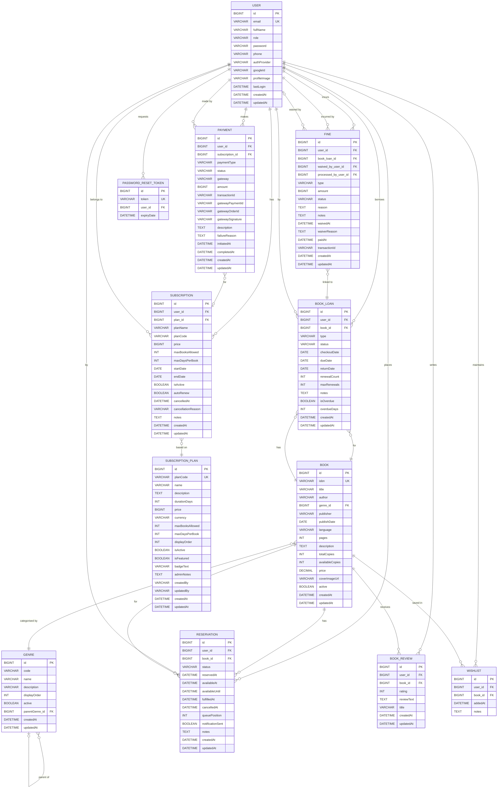
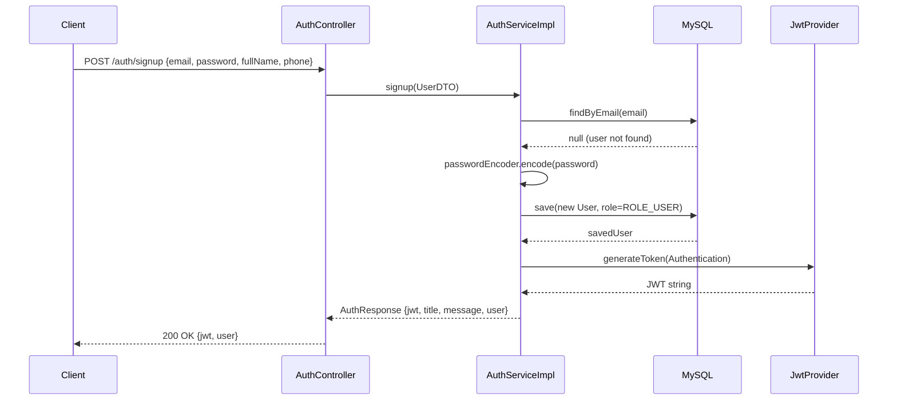
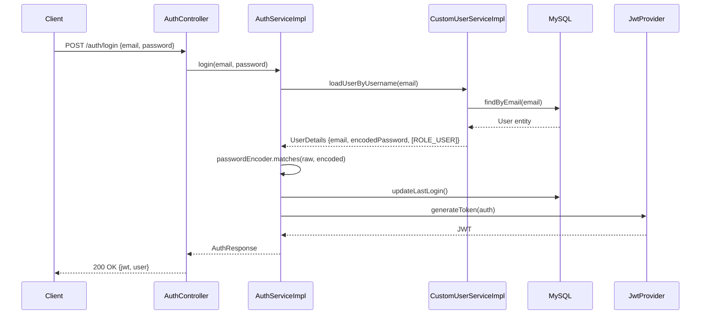
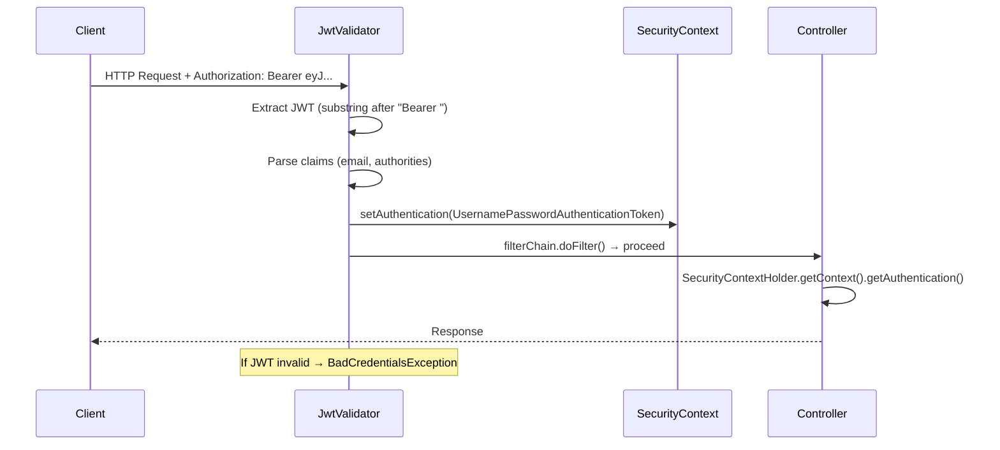
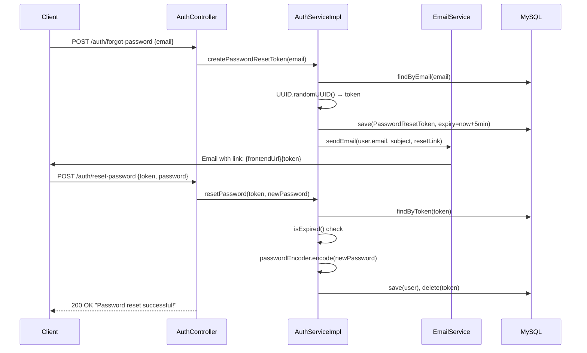

# 📚 PS Library
### *Enterprise-Grade Library Operations Platform*

---

> **A comprehensive, production-ready REST API built with Java 21 & Spring Boot 4.1, featuring JWT authentication, subscription-based membership, Razorpay payment integration, fine management, book reservation queue, review system, and event-driven architecture.**

---

## Table of Contents

1. [Executive Summary](#1-executive-summary)
2. [Project Overview](#2-project-overview)
3. [Complete Feature List](#3-complete-feature-list)
4. [Technology Stack](#4-technology-stack)
5. [Project Architecture](#5-project-architecture)
6. [Folder Structure](#6-folder-structure)
7. [Database Design](#7-database-design)
8. [Authentication & Security Flow](#8-authentication--security-flow)
9. [REST API Documentation](#9-rest-api-documentation)
10. [Backend Analysis](#10-backend-analysis)
11. [Business Logic Deep Dive](#11-business-logic-deep-dive)
12. [Security Analysis](#12-security-analysis)
13. [Validation Rules](#13-validation-rules)
14. [Exception Handling](#14-exception-handling)
15. [Design Patterns](#15-design-patterns)
16. [Code Quality Analysis](#16-code-quality-analysis)
17. [Project Statistics](#17-project-statistics)
18. [Deployment & Docker](#18-deployment--docker)
19. [Performance Optimizations](#19-performance-optimizations)
20. [Engineering Challenges & Solutions](#20-engineering-challenges--solutions)
21. [Future Improvements Roadmap](#21-future-improvements-roadmap)
22. [Conclusion](#22-conclusion)

---

## 1. Executive Summary

### Problem Statement

Traditional library operations suffer from fragmented manual processes: paper-based loan tracking, error-prone fine calculations, inefficient book reservation queuing, and no integrated payment mechanism. These inefficiencies result in poor user experience, loss of revenue from unpaid fines, and administrative overhead.

### Motivation

This project was engineered to solve these pain points by delivering a modern, API-first library management backend that can power any frontend client (web, mobile). The system centralises all library operations into a single, cohesive, secured, and scalable REST API.

### Objectives

- Provide **role-based access control** differentiating administrators from general members
- Implement **subscription-tier-based borrowing limits** (enforced at checkout time)
- Enable **real-money payment processing** via Razorpay for fines and memberships
- Support **hierarchical book genres** for nuanced catalogue organisation
- Enforce **business rules** at the service layer — overdue enforcement, review eligibility, reservation queue management
- Deliver an **event-driven** asynchronous architecture for post-payment workflows

### Target Users

| Role | Description |
|---|---|
| **ROLE_ADMIN** | Library staff with full system control — create books/plans, waive fines, manage all loans and reservations |
| **ROLE_USER** | Library members — browse books, checkout, reserve, review, manage wishlist, pay fines online |

### Business Value

- Eliminates paper-based tracking; reduces human error
- Online fine payment reduces revenue loss via Razorpay integration
- Subscription tiers create a recurring revenue stream for the library
- Reservation queue reduces wasted trips and improves member satisfaction
- Email notifications (password reset, payment confirmation) reduce support workload

### Technical Goals

- Stateless, JWT-secured REST API (horizontally scalable)
- Clean separation of concerns across 5 architectural layers
- Portable via Docker — runs anywhere
- Production-ready configuration (SMTP, Razorpay, MySQL with environment variable support)

---

## 2. Project Overview

The **PS Library** is a backend REST API application built on the Spring Boot 4.1 framework with Java 21. It communicates with a MySQL 8.x relational database via Hibernate/JPA. All security is handled statelessly using JSON Web Tokens. The application is containerised using a multi-stage Docker build.

### How It Works (High-Level Flow)

```
User/Admin Client (Frontend at localhost:5173)
        │
        ▼
   HTTP Request with Bearer JWT
        │
        ▼
 ┌─────────────────────────┐
 │  JwtValidator Filter     │ ← Intercepts every /api/** request
 │  (OncePerRequestFilter)  │   Validates token, sets SecurityContext
 └─────────────────────────┘
        │
        ▼
 ┌─────────────────────────┐
 │  Spring Security Layer   │ ← Role-based route authorization
 └─────────────────────────┘
        │
        ▼
 ┌─────────────────────────┐
 │  REST Controller Layer   │ ← Receives request, calls Service
 └─────────────────────────┘
        │
        ▼
 ┌─────────────────────────┐
 │  Service Layer           │ ← All business rules enforced here
 └─────────────────────────┘
        │
        ▼
 ┌─────────────────────────┐
 │  Repository Layer        │ ← Spring Data JPA + custom JPQL queries
 └─────────────────────────┘
        │
        ▼
 ┌─────────────────────────┐
 │  MySQL Database (lms)    │ ← Persistent storage
 └─────────────────────────┘
```

### Major Modules

| Module | Responsibility |
|---|---|
| **Auth** | User registration, login, JWT generation, password reset |
| **Books & Genres** | Catalogue management, search, soft/hard delete |
| **Book Loans** | Checkout, checkin, renewal, overdue management |
| **Reservations** | Queue-based book holds with position tracking |
| **Fines** | Manual fine creation, admin waiver, Razorpay payment initiation |
| **Payments** | Razorpay payment link creation, verification, event publishing |
| **Subscriptions** | Plan-based membership lifecycle management |
| **Subscription Plans** | Admin-managed pricing tiers |
| **Wishlist** | Personal reading list per user |
| **Reviews** | Verified purchase review system |
| **Users** | Profile access, user listing |
| **Events** | Async payment success handler → auto-activates subscription |
| **Email** | SMTP transactional email (password reset) |

---

## 3. Complete Feature List

### 🔐 Authentication & Account Management
- **User Registration** — Creates a new ROLE_USER account with BCrypt-hashed password
- **User Login** — Validates credentials, generates 24-hour JWT
- **JWT-based Authentication** — Stateless, no server-side session
- **Forgot Password** — Generates a UUID token (5-minute expiry), emails reset link to user
- **Reset Password** — Validates token expiry, encodes new password, deletes used token
- **Last Login Tracking** — Updates `lastLogin` timestamp on every successful login
- **Auth Provider Support** — Entity supports both `LOCAL` and `GOOGLE` providers (Google OAuth placeholder exists)

### 📚 Book Management (Admin & User)
- **Single Book Creation** (`ROLE_ADMIN` only via `/api/admin/books`)
- **Bulk Book Creation** — Accepts a list of BookDTOs, creates each with ISBN uniqueness check
- **Get Book by ID** — Fetches full book details including genre
- **Get Book by ISBN** — Lookup by International Standard Book Number
- **Update Book** — Full update of book attributes
- **Soft Delete** — Sets `active = false`, book remains in DB
- **Hard Delete** — Permanently removes book record from database
- **Advanced Search** — Multi-field search: title, author, ISBN, genre filter, availability filter, pagination, sorting
- **Book Statistics** — Returns total active books and total available copies
- **Availability Copy Tracking** — `availableCopies` decremented on checkout, incremented on return
- **Copy Validation** — Entity-level `@AssertTrue` ensures `availableCopies <= totalCopies`

### 🏷️ Genre Management
- **Create Genre** — With code, name, description, display order
- **Get All Genres** — Returns active genres ordered by display order
- **Get Genre by ID**
- **Update Genre**
- **Soft Delete Genre** — Sets `active = false`
- **Hard Delete Genre** — Permanent removal
- **Get Top-Level Genres** — Returns genres with no parent (hierarchical support)
- **Book Count by Genre** — Returns number of books in a given genre
- **Total Active Genre Count**
- **Hierarchical Genre Tree** — `parentGenre` and `subGenre` self-referential relationship

### 🔄 Book Loan / Circulation Management
- **Self-Checkout** — Authenticated user checks out a book for themselves
- **Admin Checkout for User** — Admin/librarian checks out a book on behalf of a specific user
- **Check-In (Return)** — Marks loan as RETURNED or LOST/DAMAGED, increments available copies
- **Loan Renewal** — Extends due date by specified days (max 2 renewals per loan)
- **My Loans** — Paginated list of the current user's loans, filterable by status
- **Search All Loans** — Admin search by user, book, status, overdue flag, date range
- **Overdue Update** — Bulk scan and mark overdue loans (CHECKED_OUT → OVERDUE)
- **Overdue Day Calculation** — Computes days past due date using `ChronoUnit.DAYS.between()`
- **Active Checkout Guard** — Prevents duplicate checkout of the same book
- **Subscription Limit Enforcement** — Enforces `maxBooksAllowed` from user's active subscription plan
- **Overdue Book Block** — User cannot checkout if they have any overdue loans

### ⏳ Reservation System
- **Create Reservation (Self)** — User reserves a book that is fully checked out
- **Create Reservation for User (Admin)** — Admin creates reservation on behalf of user
- **Cancel Reservation** — User cancels own reservation; admin can cancel any
- **Fulfill Reservation** — Admin fulfills a reservation: auto-triggers checkout for the reserved user
- **My Reservations** — User's reservations with status, pagination, sorting
- **Search All Reservations** — Admin search by user, book, status, active-only flag
- **Queue Position Tracking** — Assigns `queuePosition` based on count of pending reservations
- **Max Reservation Guard** — User may not hold more than 5 active reservations simultaneously
- **Duplicate Reservation Guard** — Prevents user from reserving same book twice
- **Availability Guard** — Reservation is rejected if book is already available (use checkout instead)
- **Existing Loan Guard** — Cannot reserve a book you currently have checked out

### 💰 Fine Management
- **Create Fine (Admin)** — Manually create a fine linked to a book loan; supports OVERDUE, DAMAGE, LOSS, PROCESSING types
- **Pay Fine** — Initiates a Razorpay payment link for fine payment (returns checkout URL)
- **Waive Fine (Admin)** — Admin can waive a pending fine with reason; records waiver audit trail
- **Mark Fine as Paid** — Internal service method invoked after payment verification
- **My Fines** — User's fines filterable by status and type
- **All Fines (Admin)** — Paginated list of all fines with user/status/type filters
- **Fine Audit Trail** — Records `waivedBy`, `waivedAt`, `waiverReason`, `processedBy`, `transactionId`, `paidAt`
- **Fine Status Machine** — States: `PENDING → PAID` or `PENDING → WAIVED`

### 💳 Subscription & Membership Management
- **Subscribe** — User selects a plan, subscription created (inactive), Razorpay payment link returned
- **Activate Subscription** — Automatically activated via `PaymentEventListener` after payment success
- **Cancel Subscription** — Marks subscription inactive with cancellation reason and timestamp
- **Get User's Active Subscription** — Returns the current valid subscription (date-range + active check)
- **Get All Subscriptions (Admin)** — Lists all subscriptions in the system
- **Deactivate Expired Subscriptions** — Bulk deactivation of subscriptions past their `endDate`
- **Plan Snapshot** — `planName`, `planCode`, `price`, `maxBooksAllowed`, `maxDaysPerBook` are snapshotted into the subscription at creation time (historical integrity)
- **End Date Calculation** — `startDate + plan.durationDays` computed automatically
- **Auto-Renew Flag** — Entity field exists for future auto-renewal implementation

### 📋 Subscription Plan Management (Admin Only)
- **Create Subscription Plan** — With plan code, name, price (INR), duration, book limits, featured flag, badge text
- **Update Subscription Plan** — Full update including admin notes
- **Delete Subscription Plan** — Removes plan from system
- **Get All Plans** — Public endpoint to display available membership tiers
- **Get Plan by Code** — Used internally by Razorpay payment verification

### 💸 Payment System (Razorpay Integration)
- **Initiate Payment** — Creates Razorpay payment link with customer details, amount (in paisa), callback URL, and metadata notes
- **Payment Link Creation** — Sends email/SMS notification to customer via Razorpay
- **Verify Payment** — Fetches payment from Razorpay API, validates `captured` status, verifies amount against plan price
- **Payment Event Publishing** — On successful verification, publishes `Payment` domain event via Spring's `ApplicationEventPublisher`
- **Payment Event Listening** — `PaymentEventListener` handles the event asynchronously (`@Async`), routes by payment type to activate subscription
- **Payment Types** — `FINE`, `MEMBERSHIP`, `LOST_BOOK_PENALTY`, `DAMAGED_BOOK_PENALTY`, `REFUND`
- **Payment Gateways** — `RAZORPAY` (implemented), `STRIPE` (enum defined, not implemented)
- **Transaction ID Tracking** — Internal `TXN_` UUID and Razorpay's `payment_link_id` both stored
- **Get All Payments (Admin)** — Paginated list with sort support

### ⭐ Book Review System
- **Create Review** — User submits rating (1–5) and review text (10–2000 chars)
- **Verified Borrower Enforcement** — User must have a RETURNED loan for the book to submit a review
- **One Review Per Book** — Each user can review a book only once
- **Update Review** — User can update own review's text, title, and rating
- **Delete Review** — User can delete own review
- **Get Reviews by Book** — Paginated list of reviews for a book, sorted by newest

### 📌 Wishlist Management
- **Add to Wishlist** — User saves a book to their personal wishlist with optional notes
- **Remove from Wishlist** — User removes a book from their wishlist
- **My Wishlist** — Paginated list of user's wishlist sorted by date added
- **Duplicate Guard** — Cannot add same book twice to wishlist

### 👤 User Management
- **Get All Users (Admin)** — Returns list of all registered users as DTOs
- **Get Current User Profile** — Returns full `User` entity for authenticated user

### 📧 Email Notifications
- **MIME Email Support** — HTML-capable email via `MimeMessageHelper`
- **Password Reset Email** — Contains time-sensitive (5 min) reset link pointing to frontend URL
- **Connection Timeout** — Configured SMTP timeouts (5000ms) prevent hangs

### 🚀 Data Initialization
- **Admin Seeding** — On startup, `DataInitializationComponent` (CommandLineRunner) checks if admin user exists and creates one if not (email: pranav.bgr@gmail.com, password: password)

---

## 4. Technology Stack

| Category | Technology | Version | Purpose |
|---|---|---|---|
| **Language** | Java | 21 (LTS) | Application logic |
| **Framework** | Spring Boot | 4.1.0 | Application container & auto-configuration |
| **Web Layer** | Spring MVC (WebMVC) | 4.1.0 | REST controller, request mapping |
| **Persistence** | Spring Data JPA | 4.1.0 | Repository abstraction |
| **ORM** | Hibernate | (via JPA) | Entity management, JPQL |
| **Database** | MySQL | 8.x | Relational data store |
| **Security** | Spring Security | 4.1.0 | Authentication & authorisation filter chain |
| **JWT** | JJWT (io.jsonwebtoken) | 0.12.6 | Token generation & validation |
| **Payment** | Razorpay Java SDK | 1.4.9 | Payment link creation & verification |
| **Email** | Spring Mail (Jakarta Mail) | 4.1.0 | SMTP transactional email |
| **Boilerplate** | Lombok | (annotation processor) | `@Getter`, `@Setter`, `@Builder`, `@RequiredArgsConstructor` |
| **Validation** | Jakarta Bean Validation | (via Spring) | `@NotBlank`, `@Min`, `@Max`, `@Size`, etc. |
| **Build Tool** | Maven | 3.x (via mvnw) | Dependency management & build |
| **Containerisation** | Docker | Multi-stage | Eclipse Temurin 21-JDK build → 21-JRE runtime |
| **Dev Tooling** | Spring Boot DevTools | (runtime scope) | Hot reload during development |
| **Testing Deps** | Spring Boot Test, Spring Security Test, Spring Data JPA Test | (test scope) | Automated test infrastructure |
| **JSON** | org.json (via Razorpay SDK) | - | JSONObject parsing for payment details |

---

## 5. Project Architecture

### Architectural Style

The application follows a **Classic N-Tier / Layered Architecture** pattern with 5 distinct layers, each with a single responsibility:

```mermaid
graph TB
    Client["🖥️ Client (React / Mobile)\nhttp://localhost:5173"]
    
    subgraph "Spring Boot Application (Port 5000)"
        Filter["🔒 JwtValidator\n(OncePerRequestFilter)\nExtracts JWT → Sets SecurityContext"]
        Security["🛡️ Spring Security FilterChain\nRole-Based Route Authorization\nCORS Configuration"]
        
        subgraph "Controller Layer"
            AC["AuthController\n/auth/**"]
            BC["BookController\n/api/books/**"]
            BLC["BookLoanController\n/api/book-loans/**"]
            FC["FineController\n/api/fines/**"]
            RC["ReservationController\n/api/reservations/**"]
            SC["SubscriptionController\n/api/subscriptions/**"]
            PC["PaymentController\n/api/payments/**"]
            GC["GenreController\n/api/genres/**"]
            BRC["BookReviewController\n/api/reviews/**"]
            WC["WishlistController\n/api/wishlist/**"]
            SPC["SubscriptionPlanController\n/api/subscription-plans/**"]
            UC["UserController\n/api/users/**"]
            AdBC["AdminBookController\n/api/admin/books/**"]
        end
        
        subgraph "Service Layer (Business Logic)"
            AS["AuthService"]
            BS["BookService"]
            BLS["BookLoanService"]
            FS["FineService"]
            RS["ReservationService"]
            SS["SubscriptionService"]
            PS["PaymentService"]
            GS["GenreService"]
            BRS["BookReviewService"]
            WS["WishlistService"]
            SPS["SubscriptionPlanService"]
            US["UserService"]
            ES["EmailService"]
            RZS["RazorpayService\n(gateway)"]
        end
        
        subgraph "Event System"
            PEP["PaymentEventPublisher\n(ApplicationEventPublisher)"]
            PEL["PaymentEventListener\n(@EventListener @Async)"]
        end
        
        subgraph "Repository Layer"
            UR["UserRepository"]
            BR["BookRepository"]
            BLR["BookLoanRepository"]
            FR["FineRepository"]
            RR["ReservationRepository"]
            SR["SubscriptionRepository"]
            PR["PaymentRepository"]
            GR["GenreRepository"]
            BRR["BookReviewRepository"]
            WR["WishlistRepository"]
            SPR["SubscriptionPlanRepository"]
            PRTR["PasswordResetTokenRepository"]
        end
        
        subgraph "Mapper Layer"
            MapBook["BookMapper"]
            MapLoan["BookLoanMapper"]
            MapFine["FineMapper"]
            MapRes["ReservationMapper"]
            MapSub["SubscriptionMapper"]
            MapPay["PaymentMapper"]
            MapUser["UserMapper"]
        end
    end
    
    DB[("🗄️ MySQL Database\n`lms`\nPort 3306")]
    Razorpay["💳 Razorpay API\n(External)"]
    SMTP["📧 Gmail SMTP\n(External)"]
    
    Client -->|"HTTP + Bearer JWT"| Filter
    Filter --> Security
    Security --> AC & BC & BLC & FC & RC & SC & PC & GC & BRC & WC & SPC & UC & AdBC
    BC & BLC & FC & RC & SC & PC & GC & BRC & WC & SPC & UC & AdBC --> AS & BS & BLS & FS & RS & SS & PS & GS & BRS & WS & SPS & US & ES
    PS --> RZS
    PS --> PEP
    PEP -->|"publishEvent"| PEL
    PEL -->|"activateSubscription"| SS
    AS --> ES
    ES --> SMTP
    RZS --> Razorpay
    AS & BS & BLS & FS & RS & SS & PS & GS & BRS & WS & SPS & US --> UR & BR & BLR & FR & RR & SR & PR & GR & BRR & WR & SPR & PRTR
    UR & BR & BLR & FR & RR & SR & PR & GR & BRR & WR & SPR & PRTR --> DB
```



### Layer Responsibilities

| Layer | Classes | Responsibility |
|---|---|---|
| **Configuration** | `SecurityConfig`, `JwtProvider`, `JwtValidator`, `JwtConstant` | Spring Security setup, CORS, JWT creation & validation, BCrypt |
| **Controller** | 14 `@RestController` classes | HTTP request handling, request/response mapping, input validation trigger |
| **Service** | 13 interface + 15 implementation classes | All business logic, business rule enforcement, cross-entity coordination |
| **Repository** | 12 `JpaRepository` interfaces | Database CRUD, custom JPQL queries, Spring Data pagination |
| **Mapper** | 11 `@Component` mapper classes | Manual conversion between JPA entities ↔ DTOs |
| **Domain/Enums** | 10 enum classes | Strongly-typed status and type constants |
| **Model/Entity** | 12 `@Entity` classes | JPA-mapped database tables |
| **Payload** | 11 DTOs, 16 request objects, 5 response objects | Data contracts for API I/O |
| **Event** | `PaymentEventPublisher` + `PaymentEventListener` | Decoupled async post-payment processing |
| **Exception** | 5 custom exceptions + `GlobalException` | Centralised error handling |

---

## 6. Folder Structure

```
library-management-system/
├── .gitattributes                    # Git line ending configuration
├── .gitignore                        # Git ignore rules
├── .idea/                            # IntelliJ IDEA project files
├── .mvn/                             # Maven wrapper configuration
│   └── wrapper/
│       └── maven-wrapper.properties
├── Dockerfile                        # Multi-stage Docker build (JDK build → JRE runtime)
├── HELP.md                           # Spring Boot generated help file
├── README.md                         # Project README (existing, 230 lines)
├── mvnw                              # Maven wrapper script (Unix)
├── mvnw.cmd                          # Maven wrapper script (Windows)
├── pom.xml                           # Maven POM — dependencies, build plugins
│
└── src/
    ├── main/
    │   ├── java/
    │   │   └── dev/pranavsharma/librarymanagementsystem/
    │   │       │
    │   │       ├── LibraryManagementSystemApplication.java   ← Entry point (@SpringBootApplication, @EnableAsync)
    │   │       │
    │   │       ├── configuration/                            ← Security & JWT infrastructure
    │   │       │   ├── JwtConstant.java                      ← JWT header name + HMAC secret key constant
    │   │       │   ├── JwtProvider.java                      ← JWT generation service (@Service)
    │   │       │   ├── JwtValidator.java                     ← OncePerRequestFilter — validates token per request
    │   │       │   └── SecurityConfig.java                   ← SecurityFilterChain, CORS, BCryptPasswordEncoder
    │   │       │
    │   │       ├── controller/                               ← REST API controllers (14 classes)
    │   │       │   ├── AdminBookController.java              ← POST /api/admin/books (ROLE_ADMIN only)
    │   │       │   ├── AuthController.java                   ← POST /auth/signup, /login, /forgot-password, /reset-password
    │   │       │   ├── BookController.java                   ← CRUD + search + stats /api/books/**
    │   │       │   ├── BookLoanController.java               ← Checkout/checkin/renew/search /api/book-loans/**
    │   │       │   ├── BookReviewController.java             ← CRUD reviews /api/reviews/**
    │   │       │   ├── FineController.java                   ← Fine management /api/fines/**
    │   │       │   ├── GenreController.java                  ← Genre CRUD /api/genres/**
    │   │       │   ├── HomeController.java                   ← GET / → welcome string
    │   │       │   ├── PaymentController.java                ← Verify + list /api/payments/**
    │   │       │   ├── ReservationController.java            ← Reservation lifecycle /api/reservations/**
    │   │       │   ├── SubscriptionController.java           ← Subscription CRUD /api/subscriptions/**
    │   │       │   ├── SubscriptionPlanController.java       ← Plan CRUD /api/subscription-plans/**
    │   │       │   ├── UserController.java                   ← User list + profile /api/users/**
    │   │       │   └── WishlistController.java               ← Wishlist management /api/wishlist/**
    │   │       │
    │   │       ├── domain/                                   ← Enums (10 types)
    │   │       │   ├── AuthProvider.java                     ← LOCAL, GOOGLE
    │   │       │   ├── BookLoanStatus.java                   ← CHECKED_OUT, RETURNED, OVERDUE, LOST, DAMAGED
    │   │       │   ├── BookLoanType.java                     ← CHECKOUT, RENEWAL, RETURN
    │   │       │   ├── FineStatus.java                       ← PENDING, PARTIALLY_PAID, PAID, WAIVED
    │   │       │   ├── FineType.java                         ← OVERDUE, DAMAGE, LOSS, PROCESSING
    │   │       │   ├── PaymentGateway.java                   ← RAZORPAY, STRIPE
    │   │       │   ├── PaymentStatus.java                    ← PENDING, SUCCESS, FAILED, CANCELLED, REFUNDED, PROCESSING
    │   │       │   ├── PaymentType.java                      ← FINE, MEMBERSHIP, LOST_BOOK_PENALTY, DAMAGED_BOOK_PENALTY, REFUND
    │   │       │   ├── ReservationStatus.java                ← PENDING, AVAILABLE, FULFILLED, CANCELLED, EXPIRED
    │   │       │   └── UserRole.java                         ← ROLE_USER, ROLE_ADMIN
    │   │       │
    │   │       ├── event/                                    ← Spring Application Events
    │   │       │   ├── listener/
    │   │       │   │   └── PaymentEventListener.java         ← @Async @EventListener → activates subscription
    │   │       │   └── publisher/
    │   │       │       └── PaymentEventPublisher.java        ← Wraps ApplicationEventPublisher
    │   │       │
    │   │       ├── exception/                                ← Custom exceptions + global handler
    │   │       │   ├── BookException.java
    │   │       │   ├── GenreException.java
    │   │       │   ├── GlobalException.java                  ← @RestControllerAdvice — currently handles GenreException
    │   │       │   ├── SubscriptionException.java
    │   │       │   └── UserException.java
    │   │       │
    │   │       ├── mapper/                                   ← Manual entity ↔ DTO converters (11 classes)
    │   │       │   ├── BookLoanMapper.java
    │   │       │   ├── BookMapper.java                       ← toDTO, toEntity, updateEntityFromDTO
    │   │       │   ├── BookReviewMapper.java
    │   │       │   ├── FineMapper.java
    │   │       │   ├── GenreMapper.java
    │   │       │   ├── PaymentMapper.java
    │   │       │   ├── ReservationMapper.java
    │   │       │   ├── SubscriptionMapper.java
    │   │       │   ├── SubscriptionPlanMapper.java
    │   │       │   ├── UserMapper.java
    │   │       │   └── WishlistMapper.java
    │   │       │
    │   │       ├── model/                                    ← JPA entities (12 tables)
    │   │       │   ├── Book.java
    │   │       │   ├── BookLoan.java
    │   │       │   ├── BookReview.java
    │   │       │   ├── Fine.java
    │   │       │   ├── Genre.java
    │   │       │   ├── PasswordResetToken.java
    │   │       │   ├── Payment.java
    │   │       │   ├── Reservation.java
    │   │       │   ├── Subscription.java
    │   │       │   ├── SubscriptionPlan.java
    │   │       │   ├── User.java
    │   │       │   └── Wishlist.java
    │   │       │
    │   │       ├── payload/                                  ← API data contracts
    │   │       │   ├── dto/                                  ← 11 Data Transfer Objects
    │   │       │   │   ├── BookDTO.java                      ← Rich validations (@NotBlank, @Size, @Min, @Max, @DecimalMin, @Digits)
    │   │       │   │   ├── BookLoanDTO.java
    │   │       │   │   ├── BookReviewDTO.java
    │   │       │   │   ├── FineDTO.java
    │   │       │   │   ├── GenreDTO.java
    │   │       │   │   ├── PaymentDTO.java
    │   │       │   │   ├── ReservationDTO.java
    │   │       │   │   ├── SubscriptionDTO.java
    │   │       │   │   ├── SubscriptionPlanDTO.java
    │   │       │   │   ├── UserDTO.java
    │   │       │   │   └── WishlistDTO.java
    │   │       │   ├── request/                              ← 16 Request payload classes
    │   │       │   │   ├── BookLoanSearchRequest.java
    │   │       │   │   ├── BookSearchRequest.java
    │   │       │   │   ├── CheckinRequest.java
    │   │       │   │   ├── CheckoutRequest.java
    │   │       │   │   ├── CreateFineRequest.java
    │   │       │   │   ├── CreateReviewRequest.java
    │   │       │   │   ├── ForgotPasswordRequest.java
    │   │       │   │   ├── LoginRequest.java
    │   │       │   │   ├── PaymentInitiateRequest.java
    │   │       │   │   ├── PaymentVerifyRequest.java
    │   │       │   │   ├── RenewalRequest.java
    │   │       │   │   ├── ReservationRequest.java
    │   │       │   │   ├── ReservationSearchRequest.java
    │   │       │   │   ├── ResetPasswordRequest.java
    │   │       │   │   ├── UpdateReviewRequest.java
    │   │       │   │   └── WaivedFineRequest.java
    │   │       │   └── response/                             ← 5 Response wrapper classes
    │   │       │       ├── ApiResponse.java                  ← Generic { message, success } wrapper
    │   │       │       ├── AuthResponse.java                 ← { jwt, message, title, user }
    │   │       │       ├── PageResponse.java                 ← Generic paginated wrapper
    │   │       │       ├── PaymentInitiateResponse.java      ← { paymentId, gateway, checkoutUrl, ... }
    │   │       │       └── PaymentLinkResponse.java          ← { payment_link_url, payment_link_id }
    │   │       │
    │   │       ├── repository/                               ← Spring Data JPA interfaces (12 repos)
    │   │       │   ├── BookLoanRepository.java
    │   │       │   ├── BookRepository.java
    │   │       │   ├── BookReviewRepository.java
    │   │       │   ├── FineRepository.java
    │   │       │   ├── GenreRepository.java
    │   │       │   ├── PasswordResetTokenRepository.java
    │   │       │   ├── PaymentRepository.java
    │   │       │   ├── ReservationRepository.java
    │   │       │   ├── SubscriptionPlanRepository.java
    │   │       │   ├── SubscriptionRepository.java
    │   │       │   ├── UserRepository.java
    │   │       │   └── WishlistRepository.java
    │   │       │
    │   │       └── service/                                  ← Business logic layer
    │   │           ├── AuthService.java
    │   │           ├── BookLoanService.java
    │   │           ├── BookReviewService.java
    │   │           ├── BookService.java
    │   │           ├── EmailService.java
    │   │           ├── FineService.java
    │   │           ├── GenreService.java
    │   │           ├── PaymentService.java
    │   │           ├── ReservationService.java
    │   │           ├── SubscriptionPlanService.java
    │   │           ├── SubscriptionService.java
    │   │           ├── UserService.java
    │   │           ├── WishlistService.java
    │   │           ├── gateway/
    │   │           │   └── RazorpayService.java              ← Razorpay SDK integration
    │   │           └── impl/                                 ← 15 service implementations
    │   │               ├── AuthServiceImpl.java
    │   │               ├── BookLoanServiceImpl.java
    │   │               ├── BookReviewServiceImpl.java
    │   │               ├── BookServiceImpl.java
    │   │               ├── CustomUserServiceImpl.java        ← UserDetailsService impl for Spring Security
    │   │               ├── DataInitializationComponent.java  ← CommandLineRunner — admin seeding
    │   │               ├── EmailServiceImpl.java
    │   │               ├── FineServiceImpl.java
    │   │               ├── GenreServiceImpl.java
    │   │               ├── PaymentServiceImpl.java
    │   │               ├── ReservationServiceImpl.java
    │   │               ├── SubscriptionImpl.java
    │   │               ├── SubscriptionPlanServiceImpl.java
    │   │               ├── UserServiceImpl.java
    │   │               └── WishlistServiceImpl.java
    │
    │   └── resources/
    │       ├── application.properties                        ← All configuration (DB, mail, Razorpay, port)
    │       ├── static/                                       ← Empty (no static assets — pure API backend)
    │       └── templates/                                    ← Empty (no Thymeleaf templates — pure REST)
    │
    └── test/
        └── java/                                            ← Test directory (no test classes authored)
```

---

## 7. Database Design

### Entity Relationship Diagram



### Table Descriptions

| Table | Primary Key | Foreign Keys | Unique Constraints | Notes |
|---|---|---|---|---|
| `user` | `id` (BIGINT AUTO) | — | `email` | Supports LOCAL and GOOGLE auth providers |
| `genre` | `id` (BIGINT AUTO) | `parentGenre_id → genre.id` | — | Self-referential for sub-genres |
| `book` | `id` (BIGINT AUTO) | `genre_id → genre.id` | `isbn` | `active=true` = soft delete flag |
| `subscription_plan` | `id` (BIGINT AUTO) | — | `planCode` | Price stored in rupees (INR) |
| `subscription` | `id` (BIGINT AUTO) | `user_id`, `plan_id` | — | Plan data snapshotted at time of creation |
| `payment` | `id` (BIGINT AUTO) | `user_id`, `subscription_id` | — | `transactionId` is internal UUID; `gatewayOrderId` is Razorpay's |
| `book_loan` | `id` (BIGINT AUTO) | `user_id`, `book_id` | — | `maxRenewals=2` enforced in entity |
| `fine` | `id` (BIGINT AUTO) | `user_id`, `book_loan_id`, `waived_by_user_id`, `processed_by_user_id` | — | Multi-user audit trail on fines |
| `reservation` | `id` (BIGINT AUTO) | `user_id`, `book_id` | — | `queuePosition` managed in service layer |
| `book_review` | `id` (BIGINT AUTO) | `user_id`, `book_id` | — | Only users with RETURNED loan can review |
| `wishlist` | `id` (BIGINT AUTO) | `user_id`, `book_id` | — | Unique per user-book pair enforced in service |
| `password_reset_token` | `id` (BIGINT AUTO) | `user_id` | `token` | Expires in 5 minutes; deleted after use |

---

## 8. Authentication & Security Flow

### JWT Token Structure

**Token Header:** `Authorization: Bearer <jwt_token>`

**Token Claims:**
```json
{
  "iat": 1700000000,
  "exp": 1700086400,
  "email": "user@example.com",
  "authorities": "ROLE_USER"
}
```

**Secret Key:** HMAC-SHA based, 72-character hardcoded string (production concern — should be externalized)

**Expiry:** 86,400,000 ms = 24 hours

### Registration Flow



### Login Flow



### Request Authentication Flow



### Password Reset Flow



### Authorization Rules

| Pattern | Required Role | Description |
|---|---|---|
| `/auth/**` | None (Public) | Registration, login, password reset |
| `/` | None (Public) | Home endpoint |
| `/api/admin/**` | `ROLE_ADMIN` | Admin-only book creation |
| `/api/subscription-plans/admin/**` | `ROLE_ADMIN` | Plan management (create/update/delete) |
| `/api/**` | Authenticated (any role) | All other endpoints require a valid JWT |

---

## 9. REST API Documentation

### Base URL: `http://localhost:5000`

> **Auth Note:** All `/api/**` endpoints require: `Authorization: Bearer <JWT_TOKEN>` header.
> `/auth/**` endpoints are fully public.

---

### 9.1 Authentication Endpoints

| Method | Endpoint | Description | Auth | Request Body | Response |
|---|---|---|---|---|---|
| `POST` | `/auth/signup` | Register new user | None | `UserDTO` {email, password, fullName, phone} | `AuthResponse` {jwt, title, message, user} |
| `POST` | `/auth/login` | Login existing user | None | `LoginRequest` {email, password} | `AuthResponse` {jwt, title, message, user} |
| `POST` | `/auth/forgot-password` | Send password reset email | None | `ForgotPasswordRequest` {email} | `ApiResponse` {message, success} |
| `POST` | `/auth/reset-password` | Reset password with token | None | `ResetPasswordRequest` {token, password} | `ApiResponse` {message, success} |

---

### 9.2 Book Endpoints

| Method | Endpoint | Description | Auth | Request Body / Params | Response |
|---|---|---|---|---|---|
| `POST` | `/api/admin/books` | Create single book | `ROLE_ADMIN` | `BookDTO` (full) | `BookDTO` |
| `POST` | `/api/books/bulk` | Create books in bulk | Authenticated | `List<BookDTO>` | `List<BookDTO>` |
| `GET` | `/api/books/{id}` | Get book by ID | Authenticated | — | `BookDTO` |
| `GET` | `/api/books/isbn/{isbn}` | Get book by ISBN | Authenticated | — | `BookDTO` |
| `PUT` | `/api/books/{id}` | Update book | Authenticated | `BookDTO` | `BookDTO` |
| `DELETE` | `/api/books/{id}` | Soft delete book | Authenticated | — | `ApiResponse` |
| `DELETE` | `/api/books/{id}/permanent` | Hard delete book | Authenticated | — | `ApiResponse` |
| `GET` | `/api/books` | List/search books | Authenticated | `?genreId, availableOnly, activeOnly, page, size, sortBy, sortDirection` | `PageResponse<BookDTO>` |
| `POST` | `/api/books/search` | Advanced search | Authenticated | `BookSearchRequest` {searchTerm, genreId, availableOnly, page, size, sortBy, sortDirection} | `PageResponse<BookDTO>` |
| `GET` | `/api/books/stats` | Book statistics | Authenticated | — | `{totalActiveBooks, totalAvailableBooks}` |

**BookDTO Validation Rules:**
- `isbn`: `@NotBlank`
- `title`: `@NotBlank`, `@Size(1–255)`
- `author`: `@NotBlank`, `@Size(1–255)`
- `genreId`: `@NotNull`
- `publisher`: `@Size(max=100)`
- `language`: `@Size(max=20)`
- `pages`: `@Min(1)`, `@Max(50000)`
- `description`: `@Size(max=2000)`
- `totalCopies`: `@NotNull`, `@Min(0)`
- `availableCopies`: `@NotNull`, `@Min(0)`
- `price`: `@DecimalMin(0.0)`, `@Digits(integer=8, fraction=2)`
- `coverImageUrl`: `@Size(max=500)`

---

### 9.3 Genre Endpoints

| Method | Endpoint | Description | Auth | Request Body | Response |
|---|---|---|---|---|---|
| `POST` | `/api/genres/create` | Create genre | Authenticated | `GenreDTO` | `GenreDTO` |
| `GET` | `/api/genres` | Get all genres | Authenticated | — | `List<GenreDTO>` |
| `GET` | `/api/genres/{id}` | Get genre by ID | Authenticated | — | `GenreDTO` |
| `PUT` | `/api/genres/{id}` | Update genre | Authenticated | `GenreDTO` | `GenreDTO` |
| `DELETE` | `/api/genres/{id}` | Soft delete genre | Authenticated | — | `ApiResponse` |
| `DELETE` | `/api/genres/{id}/permanent` | Hard delete genre | Authenticated | — | `ApiResponse` |
| `GET` | `/api/genres/top-level` | Get root genres | Authenticated | — | `List<GenreDTO>` |
| `GET` | `/api/genres/count` | Count active genres | Authenticated | — | `Long` |
| `GET` | `/api/genres/{id}/book-count` | Book count in genre | Authenticated | — | `Long` |

---

### 9.4 Book Loan Endpoints

| Method | Endpoint | Description | Auth | Request Body / Params | Response |
|---|---|---|---|---|---|
| `POST` | `/api/book-loans/checkout` | Self checkout | Authenticated | `CheckoutRequest` {bookId, checkoutDays=14, notes} | `BookLoanDTO` (201) |
| `POST` | `/api/book-loans/checkout/user/{userId}` | Checkout for user (Admin) | Authenticated | `CheckoutRequest` | `BookLoanDTO` (201) |
| `POST` | `/api/book-loans/checkin` | Return book | Authenticated | `CheckinRequest` {bookLoanId, condition} | `BookLoanDTO` (200) |
| `POST` | `/api/book-loans/renew` | Renew checkout | Authenticated | `RenewalRequest` {bookLoanId, extensionDays} | `BookLoanDTO` (200) |
| `GET` | `/api/book-loans/my` | My loans | Authenticated | `?status, page=0, size=20` | `PageResponse<BookLoanDTO>` |
| `POST` | `/api/book-loans/search` | Search all loans (Admin) | Authenticated | `BookLoanSearchRequest` | `PageResponse<BookLoanDTO>` |
| `POST` | `/api/book-loans/admin/update-overdue` | Mark overdue loans | Authenticated | — | `ApiResponse` |

**CheckoutRequest Validation:**
- `bookId`: `@NotNull`
- `checkoutDays`: `@Min(1)`, default 14

---

### 9.5 Reservation Endpoints

| Method | Endpoint | Description | Auth | Request Body / Params | Response |
|---|---|---|---|---|---|
| `POST` | `/api/reservations` | Reserve a book (self) | Authenticated | `ReservationRequest` {bookId, notes} | `ReservationDTO` (200) |
| `POST` | `/api/reservations/user/{userId}` | Reserve for user (Admin) | Authenticated | `ReservationRequest` | `ReservationDTO` (201) |
| `DELETE` | `/api/reservations/{id}` | Cancel reservation | Authenticated | — | `ReservationDTO` (200) |
| `POST` | `/api/reservations/{id}/fulfill` | Fulfill reservation (Admin) | Authenticated | — | `ReservationDTO` (200) |
| `GET` | `/api/reservations/my` | My reservations | Authenticated | `?status, activeOnly, page, size, sortBy, sortDirection` | `PageResponse<ReservationDTO>` |
| `GET` | `/api/reservations` | Search all reservations | Authenticated | `?userId, bookId, status, activeOnly, page, size, sortBy, sortDirection` | `PageResponse<ReservationDTO>` |

**Business Rule Errors:**
- 409: Already has active loan on this book
- 409: Already has reservation on this book
- 409: Book is already available (checkout instead)
- 429: Maximum 5 active reservations reached
- 403: Cannot cancel another user's reservation (unless admin)

---

### 9.6 Fine Endpoints

| Method | Endpoint | Description | Auth | Request Body / Params | Response |
|---|---|---|---|---|---|
| `POST` | `/api/fines` | Create fine (Admin) | Authenticated | `CreateFineRequest` {bookLoanId, type, amount, reason, notes} | `FineDTO` |
| `POST` | `/api/fines/{id}/pay` | Pay fine (initiates payment) | Authenticated | `?transactionId` | `PaymentInitiateResponse` |
| `POST` | `/api/fines/waive` | Waive fine (Admin) | Authenticated | `WaivedFineRequest` {fineId, reason} | `FineDTO` |
| `GET` | `/api/fines/my` | My fines | Authenticated | `?status, type` | `List<FineDTO>` |
| `GET` | `/api/fines` | All fines (Admin) | Authenticated | `?status, type, userId, page=0, size=20` | `PageResponse<FineDTO>` |

**CreateFineRequest Validation:**
- `bookLoanId`: `@NotNull`
- `type`: `@NotNull` (OVERDUE, DAMAGE, LOSS, PROCESSING)
- `amount`: `@NotNull`, `@Positive`

---

### 9.7 Payment Endpoints

| Method | Endpoint | Description | Auth | Request Body / Params | Response |
|---|---|---|---|---|---|
| `POST` | `/api/payments/verify` | Verify Razorpay payment | Authenticated | `PaymentVerifyRequest` {razorpayPaymentId} | `PaymentDTO` |
| `GET` | `/api/payments` | All payments (Admin) | Authenticated | `?page=0, size=10, sortBy=createdAt, sortDir=DESC` | `Page<PaymentDTO>` |

**Payment Verification Flow:**
1. Fetch payment details from Razorpay using `paymentId`
2. Extract internal `payment_id` from Razorpay `notes` field
3. Validate payment status = "captured"
4. Validate amount matches plan price
5. Mark payment as `SUCCESS`, publish `PaymentSuccessEvent`
6. `PaymentEventListener` asynchronously activates subscription

---

### 9.8 Subscription Endpoints

| Method | Endpoint | Description | Auth | Request Body / Params | Response |
|---|---|---|---|---|---|
| `POST` | `/api/subscriptions/subscribe` | Subscribe to a plan | Authenticated | `SubscriptionDTO` {planId} | `PaymentInitiateResponse` (checkout URL) |
| `GET` | `/api/subscriptions/user/active` | Get active subscription | Authenticated | `?userId` | `SubscriptionDTO` |
| `GET` | `/api/subscriptions/admin` | All subscriptions | Authenticated | — | `List<SubscriptionDTO>` |
| `GET` | `/api/subscriptions/admin/deactivate-expired` | Deactivate expired | Authenticated | — | `ApiResponse` |
| `POST` | `/api/subscriptions/cancel/{id}` | Cancel subscription | Authenticated | `?reason` | `SubscriptionDTO` |
| `POST` | `/api/subscriptions/activate` | Manually activate | Authenticated | `?subscriptionId, paymentId` | `SubscriptionDTO` |

---

### 9.9 Subscription Plan Endpoints

| Method | Endpoint | Description | Auth | Request Body | Response |
|---|---|---|---|---|---|
| `GET` | `/api/subscription-plans` | Get all plans | Authenticated | — | `List<SubscriptionPlanDTO>` |
| `POST` | `/api/subscription-plans/admin/create` | Create plan | `ROLE_ADMIN` | `SubscriptionPlanDTO` | `SubscriptionPlanDTO` |
| `PUT` | `/api/subscription-plans/admin/{id}` | Update plan | `ROLE_ADMIN` | `SubscriptionPlanDTO` | `SubscriptionPlanDTO` |
| `DELETE` | `/api/subscription-plans/admin/{id}` | Delete plan | `ROLE_ADMIN` | — | `ApiResponse` |

---

### 9.10 Review Endpoints

| Method | Endpoint | Description | Auth | Request Body | Response |
|---|---|---|---|---|---|
| `POST` | `/api/reviews` | Create review | Authenticated | `CreateReviewRequest` {bookId, rating(1-5), reviewText(10-2000), title} | `BookReviewDTO` |
| `PUT` | `/api/reviews/{id}` | Update review | Authenticated | `UpdateReviewRequest` | `BookReviewDTO` |
| `DELETE` | `/api/reviews/{reviewId}` | Delete review | Authenticated | — | `ApiResponse` |
| `GET` | `/api/reviews/book/{bookId}` | Get reviews for book | Authenticated | `?page=0, size=20` | `PageResponse<BookReviewDTO>` |

**Business Rules:**
- User must have a `RETURNED` book loan to submit a review
- Each user may only review a book once
- User may only edit/delete their own reviews

---

### 9.11 Wishlist Endpoints

| Method | Endpoint | Description | Auth | Params | Response |
|---|---|---|---|---|---|
| `POST` | `/api/wishlist/add/{bookId}` | Add to wishlist | Authenticated | `?notes` | `WishlistDTO` |
| `DELETE` | `/api/wishlist/remove/{bookId}` | Remove from wishlist | Authenticated | — | `ApiResponse` |
| `GET` | `/api/wishlist/my` | My wishlist | Authenticated | `?page=0, size=20` | `PageResponse<WishlistDTO>` |

---

### 9.12 User Endpoints

| Method | Endpoint | Description | Auth | Response |
|---|---|---|---|---|
| `GET` | `/api/users/list` | All users | Authenticated | `List<UserDTO>` |
| `GET` | `/api/users/profile` | Current user profile | Authenticated | `User` (full entity) |

---

### 9.13 Home Endpoint

| Method | Endpoint | Description | Auth | Response |
|---|---|---|---|---|
| `GET` | `/` | Health check / welcome | None | `"Welcome to PS Library"` |

---

## 10. Backend Analysis

### Controllers Analysis

| Controller | Base Path | Endpoints | Key Dependencies |
|---|---|---|---|
| `AuthController` | `/auth` | 4 | `AuthService` |
| `AdminBookController` | `/api/admin/books` | 1 | `BookService` |
| `BookController` | `/api/books` | 9 | `BookService` |
| `BookLoanController` | `/api/book-loans` | 7 | `BookLoanService` |
| `BookReviewController` | `/api/reviews` | 4 | `BookReviewService` |
| `FineController` | `/api/fines` | 5 | `FineService` |
| `GenreController` | `/api/genres` | 9 | `GenreService` |
| `HomeController` | `/` | 1 | — |
| `PaymentController` | `/api/payments` | 2 | `PaymentService` |
| `ReservationController` | `/api/reservations` | 6 | `ReservationService` |
| `SubscriptionController` | `/api/subscriptions` | 6 | `SubscriptionService` |
| `SubscriptionPlanController` | `/api/subscription-plans` | 4 | `SubscriptionPlanService` |
| `UserController` | `/api/users` | 2 | `UserService` |
| `WishlistController` | `/api/wishlist` | 3 | `WishlistService` |

### Service Layer Analysis

| Service Interface | Implementation | Key Method Count | Complexity |
|---|---|---|---|
| `AuthService` | `AuthServiceImpl` | 4 | Medium — JWT, BCrypt, email, token |
| `BookService` | `BookServiceImpl` | 8 | Low — standard CRUD + search |
| `BookLoanService` | `BookLoanServiceImpl` | 7 | **High** — 9-step checkout, overdue logic |
| `BookReviewService` | `BookReviewServiceImpl` | 4 | Medium — verified borrower check |
| `FineService` | `FineServiceImpl` | 6 | Medium — payment initiation, waiver audit |
| `GenreService` | `GenreServiceImpl` | 8 | Low — hierarchical genre ops |
| `PaymentService` | `PaymentServiceImpl` | 3 | **High** — Razorpay, event publishing |
| `ReservationService` | `ReservationServiceImpl` | 6 | **High** — queue management, 6 guard conditions |
| `SubscriptionService` | `SubscriptionImpl` | 6 | High — payment orchestration, expiry management |
| `SubscriptionPlanService` | `SubscriptionPlanServiceImpl` | 5 | Low — admin CRUD |
| `UserService` | `UserServiceImpl` | 3 | Low — SecurityContext extraction |
| `WishlistService` | `WishlistServiceImpl` | 3 | Low — simple CRUD |
| `EmailService` | `EmailServiceImpl` | 1 | Low — MIME email wrapper |
| — | `CustomUserServiceImpl` | 1 | Low — Spring Security UserDetailsService |
| — | `DataInitializationComponent` | 1 | Low — CommandLineRunner admin seed |
| — | `RazorpayService` (gateway) | 3 | **High** — Razorpay SDK, signature validation |

### Repository Analysis

| Repository | Extends | Custom JPQL Queries | Notable Queries |
|---|---|---|---|
| `BookRepository` | `JpaRepository<Book, Long>` | 2 | `searchBooksWithFilters` (full-text multi-field), `countAvailableBooks` |
| `BookLoanRepository` | `JpaRepository<BookLoan, Long>` | 5 | `hasActiveCheckout`, `countActiveByUser`, `countOverdueByUser`, `findOverdue`, `findByDateRange` |
| `FineRepository` | `JpaRepository<Fine, Long>` | 1 | `findAllWithFilters` (dynamic multi-param JPQL) |
| `GenreRepository` | `JpaRepository<Genre, Long>` | 0 | Spring Data method queries (derived) |
| `ReservationRepository` | `JpaRepository<Reservation, Long>` | 4 | `hasActiveReservation`, `countActive`, `countPending`, `searchWithFilters` |
| `SubscriptionRepository` | `JpaRepository<Subscription, Long>` | 2 | `findActiveByUserId` (date-range + active), `findExpiredActive` |
| `UserRepository` | `JpaRepository<User, Long>` | 0 | `findByEmail` (derived query) |
| `WishlistRepository` | `JpaRepository<Wishlist, Long>` | 0 | `existsByUserIdAndBookId`, `findByUserIdAndBookId` (derived) |
| `BookReviewRepository` | `JpaRepository<BookReview, Long>` | 0 | `existsByUserIdAndBookId`, `findByBook` (derived) |
| `PaymentRepository` | `JpaRepository<Payment, Long>` | 0 | `findAll` (standard) |
| `SubscriptionPlanRepository` | `JpaRepository<SubscriptionPlan, Long>` | 0 | `findByPlanCode` (derived) |
| `PasswordResetTokenRepository` | `JpaRepository<PasswordResetToken, Long>` | 0 | `findByToken` (derived) |

### Mapper Layer Analysis

The Mapper layer uses **manual mapping** (custom `@Component` classes), not MapStruct. Each mapper has:
- `toDTO(Entity)` — Entity → DTO for API responses
- `toEntity(DTO)` — DTO → Entity for persistence (where applicable)
- `updateEntityFromDTO(DTO, Entity)` — Partial update pattern (BookMapper)
- `toDTOList(List<Entity>)` — Batch conversion (SubscriptionMapper)

The `BookMapper` is notably more complex — it resolves `genreId` to a full `Genre` entity from the repository during `toEntity()`, bridging the DTO world and the JPA world cleanly.

---

## 11. Business Logic Deep Dive

### 11.1 Book Checkout Logic (9-Step Process)

```
checkoutBookForUser(userId, CheckoutRequest)
    │
    ├─ Step 1: Validate user exists → UserService.findById()
    ├─ Step 2: Validate active subscription → SubscriptionService.getUsersActiveSubscription()
    │           └─ Throws SecurityException if no active subscription
    ├─ Step 3: Validate book exists → BookRepository.findById()
    │           └─ Throws BookException if book not found
    ├─ Step 4: Validate book is active → book.getActive() == true
    ├─ Step 5: Validate book availability → book.getAvailableCopies() > 0
    ├─ Step 6: Check no duplicate checkout → BookLoanRepository.hasActiveCheckout()
    ├─ Step 7: Check subscription limit → countActiveLoans < maxBooksAllowed
    ├─ Step 8: Check no overdue loans → countOverdueLoans == 0
    ├─ Step 9: Create BookLoan entity (CHECKED_OUT, dueDate = today + checkoutDays)
    ├─ Step 10: Decrement book.availableCopies by 1, save Book
    └─ Step 11: Save BookLoan, return DTO
```

### 11.2 Book Return (Check-In) Logic

```
checkinBook(CheckinRequest)
    ├─ Validate book loan exists
    ├─ Validate loan is active (CHECKED_OUT or OVERDUE)
    ├─ Set returnDate = today
    ├─ Set status = checkinRequest.condition (default: RETURNED)
    ├─ Reset isOverdue = false, overdueDays = 0
    ├─ If condition != LOST → increment book.availableCopies (book returned physically)
    └─ Save and return DTO
```

### 11.3 Renewal Logic

```
renewCheckout(RenewalRequest)
    ├─ Validate loan exists
    ├─ bookLoan.canRenew() → status == CHECKED_OUT && !isOverdue && renewalCount < maxRenewals(2)
    ├─ dueDate += extensionDays
    ├─ renewalCount++
    └─ Save and return DTO
```

### 11.4 Reservation Queue Logic

```
createReservation(request, userId)
    ├─ Guard: user doesn't already have active loan on this book
    ├─ Guard: no existing active reservation on this book
    ├─ Guard: book.availableCopies == 0 (must be checked out)
    ├─ Guard: user's active reservations < MAX_RESERVATIONS (5)
    ├─ queuePosition = countPendingReservationsByBook() + 1
    └─ Create Reservation (PENDING, reservedAt=now, notificationSent=false)

fulfillReservation(reservationId) [Admin Only]
    ├─ Validate reservation exists
    ├─ Validate book.availableCopies > 0
    ├─ Set status = FULFILLED
    └─ Trigger checkoutBookForUser(reservation.user.id, request)
```

### 11.5 Fine Payment Flow

```
payFine(fineId, transactionId)
    ├─ Validate fine exists
    ├─ Guard: fine.status != PAID (already paid)
    ├─ Guard: fine.status != WAIVED (already waived)
    ├─ Build PaymentInitiateRequest {userId, fineId, type=FINE, gateway=RAZORPAY, amount}
    └─ PaymentService.initiatePayment() → returns Razorpay checkout URL
```

### 11.6 Subscription Activation (Event-Driven)

```
User subscribes → PaymentService.initiatePayment()
    → Razorpay payment link created, returned to user
    
User pays on Razorpay → Redirected to frontend /payment-success/{paymentId}

Frontend calls → POST /api/payments/verify {razorpayPaymentId}
    → PaymentServiceImpl.verifyPayment()
    → fetchPaymentDetails() from Razorpay
    → isValidPayment() → status == "captured" && amount matches plan price
    → payment.status = SUCCESS, save
    → PaymentEventPublisher.publishPaymentSuccessEvent(payment)
    
    [Async Thread]
    → PaymentEventListener.handlePaymentSuccess(payment)
    → switch(MEMBERSHIP) → SubscriptionService.activateSubscription()
    → subscription.isActive = true, save
```

### 11.7 Book Availability & Search Logic

The `BookRepository.searchBooksWithFilters()` JPQL query supports:
- **Full-text search**: case-insensitive `LIKE` across `title`, `author`, and `isbn`
- **Genre filter**: exact match on `genre.id`
- **Availability filter**: `availableCopies > 0`
- **Active filter**: always `active = true` (soft-deleted books excluded)
- **Pagination**: Spring Data `Pageable` with configurable sort

Page size for book search is **capped at 10** (line 119 of `BookServiceImpl.java`) — a deliberate safeguard.

### 11.8 Overdue Detection & Update

```
updateOverdueBookLoan()
    ├─ Query: all loans where dueDate < today AND status IN (CHECKED_OUT, OVERDUE)
    ├─ For each loan where status == CHECKED_OUT:
    │   ├─ status → OVERDUE
    │   ├─ isOverdue → true
    │   └─ overdueDays = ChronoUnit.DAYS.between(dueDate, today)
    └─ Return count of updated records
```

> **Note:** Fine auto-creation upon overdue marking is commented out (`// Calculate fine todo`) — currently a manual admin operation.

### 11.9 Verified Review Enforcement

```
createReview(request)
    ├─ Guard: user hasn't already reviewed this book
    ├─ hasUserReadBook(userId, bookId):
    │   └─ Query all book loans for this book
    │   └─ Return true if ANY loan has userId == currentUser AND status == RETURNED
    └─ Create review only if user has a RETURNED loan
```

---

## 12. Security Analysis

### Spring Security Configuration

The `SecurityConfig` defines a single `SecurityFilterChain`:

```java
.sessionManagement(STATELESS)
.authorizeHttpRequests(
    /api/subscription-plans/admin/** → hasRole("ADMIN")
    /api/admin/**                    → hasRole("ADMIN")
    /api/**                          → authenticated()
    anyRequest                       → permitAll()
)
.addFilterBefore(new JwtValidator(), BasicAuthenticationFilter.class)
.csrf(disabled)
.cors(configured)
```

### CORS Configuration

| Setting | Value |
|---|---|
| Allowed Origins | `http://localhost:5173/` |
| Allowed Methods | `*` (all HTTP methods) |
| Allowed Headers | `*` (all headers) |
| Exposed Headers | `Authorization` |
| Allow Credentials | `true` |
| Max Age | 3600 seconds (1 hour preflight cache) |

> **Security Note:** Production deployment requires CORS origins to be updated to actual domain(s) and ideally read from environment variables.

### JWT Security

| Attribute | Value |
|---|---|
| Algorithm | HMAC-SHA (Keys.hmacShaKeyFor) |
| Secret | 72-char hardcoded string (production risk — should be externalized via env var) |
| Header | `Authorization` |
| Prefix | `Bearer ` |
| Token Lifetime | 86,400,000 ms (24 hours) |
| Claims | `email`, `authorities`, `iat`, `exp` |

### Password Security

- Algorithm: `BCryptPasswordEncoder` (default strength 10 rounds)
- Passwords never stored in plaintext
- No plain password logging

### CSRF

CSRF is **disabled** — appropriate for a stateless REST API (not relying on browser cookie-based sessions).

### SQL Injection Prevention

- All database queries use **JPQL with named parameters** (`@Param`) — never string concatenation
- Spring Data JPA's derived query methods are inherently parameterized

### Input Validation

- Jakarta Bean Validation annotations on DTOs: `@NotBlank`, `@NotNull`, `@Min`, `@Max`, `@Size`, `@Positive`, `@DecimalMin`, `@Digits`
- `@Valid` on all controller method parameters triggers validation automatically
- Entity-level validation: `@AssertTrue` on `Book.isAvailableCopiesValid()`

### Known Security Concerns (Areas for Improvement)

1. **Hardcoded JWT secret** in `JwtConstant.java` — should use `@Value("${app.jwt.secret}")`
2. **Admin credentials** hardcoded in `DataInitializationComponent.java`
3. **Razorpay keys** in `application.properties` (not in `.env` or secrets manager)
4. **CORS** allows wildcard methods and headers — should be restricted in production
5. **`/api/users/profile`** returns the full `User` entity (including `password` hash, `googleId`) — should return a DTO instead

---

## 13. Validation Rules

### BookDTO
| Field | Rule | Message |
|---|---|---|
| isbn | `@NotBlank` | "ISBN is mandatory!" |
| title | `@NotBlank`, `@Size(1,255)` | "Title is mandatory!", "1 to 255 characters" |
| author | `@NotBlank`, `@Size(1,255)` | "Author name is mandatory!" |
| genreId | `@NotNull` | "Genre is mandatory!" |
| publisher | `@Size(max=100)` | "max 100 characters" |
| language | `@Size(max=20)` | "max 20 characters" |
| pages | `@Min(1)`, `@Max(50000)` | "at least 1 page", "not exceed 50000" |
| description | `@Size(max=2000)` | "max 2000 characters" |
| totalCopies | `@NotNull`, `@Min(0)` | "mandatory", "cannot be negative" |
| availableCopies | `@NotNull`, `@Min(0)` | "mandatory", "cannot be negative" |
| price | `@DecimalMin(0.0)`, `@Digits(8,2)` | "cannot be negative", "8 integer 2 decimal" |
| coverImageUrl | `@Size(max=500)` | "max 500 characters" |

### CreateReviewRequest
| Field | Rule | Message |
|---|---|---|
| bookId | `@NotNull` | "Book ID is mandatory!" |
| rating | `@NotNull`, `@Min(1)`, `@Max(5)` | "mandatory", "at least 1", "not exceed 5" |
| reviewText | `@NotBlank`, `@Size(10, 2000)` | "mandatory", "10–2000 characters" |
| title | `@Size(max=200)` | "max 200 characters" |

### CheckoutRequest
| Field | Rule | Message |
|---|---|---|
| bookId | `@NotNull` | "Book ID is mandatory!" |
| checkoutDays | `@Min(1)` | "at least 1" |

### CreateFineRequest
| Field | Rule | Message |
|---|---|---|
| bookLoanId | `@NotNull` | "Book loan ID is mandatory!" |
| type | `@NotNull` | "Fine type is mandatory!" |
| amount | `@NotNull`, `@Positive` | "mandatory", "amount is positive!" |

### PaymentInitiateRequest
| Field | Rule | Message |
|---|---|---|
| userId | `@NotNull` | "User ID is mandatory!" |
| paymentType | `@NotNull` | "Payment type is mandatory!" |
| gateway | `@NotNull` | "Payment gateway is mandatory!" |
| amount | `@NotNull`, `@Positive` | "mandatory", "must be positive!" |
| description | `@Size(max=500)` | "max 500 characters" |

### Genre Entity
| Field | Rule | Message |
|---|---|---|
| code | `@NotBlank` | "Genre Code is mandatory" |
| name | `@NotBlank` | "Genre Name is mandatory" |
| description | `@Size(max=500)` | "max 500 characters" |
| displayOrder | `@Min(0)` | "cannot be negative" |

### SubscriptionPlan Entity
| Field | Rule | Message |
|---|---|---|
| maxBooksAllowed | `@Positive` | "must have a positive value!" |
| maxDaysPerBook | `@Positive` | "must have a positive value!" |

### Entity-Level Business Validation (Book)
```java
@AssertTrue(message = "Available copies can't exceed total number of copies!")
public boolean isAvailableCopiesValid() {
    if (totalCopies == null || availableCopies == null) return true;
    return availableCopies <= totalCopies;
}
```

---

## 14. Exception Handling

### Custom Exception Classes

| Exception | Superclass | Usage |
|---|---|---|
| `BookException` | `Exception` | Book not found, ISBN conflict, unavailable, not active |
| `GenreException` | `Exception` | Genre not found, validation failures |
| `UserException` | `Exception` | User not found, duplicate email, wrong password |
| `SubscriptionException` | `Exception` | Subscription not found, already cancelled |
| Generic `Exception` | Java `Exception` | Loan not found, fine not found, reservation errors |

### Global Exception Handler

`GlobalException` extends `Exception` and is annotated with `@RestControllerAdvice`. Currently, it only handles `GenreException`:

```java
@ExceptionHandler(GenreException.class)
public ResponseEntity<ApiResponse> handleGenreException(GenreException e) {
    return ResponseEntity.status(HttpStatus.BAD_REQUEST)
            .body(new ApiResponse(e.getMessage(), false));
}
```

> **Gap Identified:** `BookException`, `UserException`, `SubscriptionException`, and generic `Exception` types are **not handled** by the global handler, meaning these propagate as unhandled exceptions. This is an area for improvement — all custom exceptions should be handled with appropriate HTTP status codes.

### Error Response Format

```json
{
  "message": "Book not found!",
  "success": false
}
```

### HTTP Status Code Usage

| Scenario | Status Code |
|---|---|
| Successful creation (checkout, reservation) | `201 Created` |
| Successful read / update | `200 OK` |
| Business rule violation (GenreException) | `400 Bad Request` |
| Payment verification failure | `400 Bad Request` |
| Validation failure (Jakarta) | `400 Bad Request` (Spring default) |
| Invalid JWT token | `401 Unauthorized` (via `BadCredentialsException`) |
| Missing subscription for checkout | Spring Security exception (varies) |

---

## 15. Design Patterns

### 1. Layered Architecture (N-Tier)
**What:** Strict separation into Controller → Service → Repository → Database layers.  
**Why:** Enforces single responsibility, simplifies testing, allows independent evolution of each layer.  
**Where:** Entire application structure.

### 2. Repository Pattern
**What:** `JpaRepository` interfaces abstract all data access behind a clean interface.  
**Why:** Decouples business logic from persistence technology; enables easy switching to another ORM/DB.  
**Where:** All 12 `*Repository.java` files.

### 3. Service Layer Pattern (Facade Pattern)
**What:** `*Service` interfaces define the business contract; `*ServiceImpl` classes provide implementation.  
**Why:** Allows multiple implementations, simplifies mocking in tests, enforces interface-based programming.  
**Where:** All service interfaces and implementations.

### 4. DTO (Data Transfer Object) Pattern
**What:** Separate `BookDTO`, `FineDTO` etc. classes for API I/O vs `Book`, `Fine` JPA entities.  
**Why:** Decouples API contract from DB schema; allows selective exposure of fields; enables validation annotations on DTOs.  
**Where:** `payload/dto/`, `payload/request/`, `payload/response/`.

### 5. Builder Pattern
**What:** Lombok `@Builder` used extensively on entities and request/response classes.  
**Why:** Improves readability when constructing complex objects; avoids telescoping constructor anti-pattern.  
**Where:** `BookLoan.builder()`, `Fine.builder()`, `PaymentInitiateResponse.builder()`, etc.

### 6. Observer / Event-Driven Pattern
**What:** `PaymentEventPublisher` publishes a `Payment` domain event; `PaymentEventListener` handles it asynchronously.  
**Why:** Decouples payment processing from subscription activation; allows future listeners (emails, notifications) without modifying `PaymentService`.  
**Where:** `event/publisher/`, `event/listener/`.

### 7. Template Method Pattern
**What:** `OncePerRequestFilter` is a template; `JwtValidator.doFilterInternal()` implements the specific JWT validation step.  
**Why:** Spring's filter infrastructure provides the execution framework; subclass provides the domain-specific logic.  
**Where:** `JwtValidator.java`.

### 8. Strategy Pattern (Implicit)
**What:** Payment gateway selection based on `PaymentGateway` enum (RAZORPAY/STRIPE); `RazorpayService` is one strategy.  
**Why:** Allows adding new gateways without changing the `PaymentService` core logic.  
**Where:** `PaymentServiceImpl`, `RazorpayService`.

### 9. Command Runner Pattern
**What:** `DataInitializationComponent implements CommandLineRunner` runs admin seeding on application startup.  
**Why:** Clean way to execute startup logic in Spring Boot without `@PostConstruct` clutter.  
**Where:** `DataInitializationComponent.java`.

### 10. Mapper / Translator Pattern
**What:** Dedicated `*Mapper` `@Component` classes convert between entities and DTOs.  
**Why:** Keeps entity classes free of DTO logic; mapper classes are testable in isolation.  
**Where:** All 11 mapper classes.

### 11. Singleton Pattern (via Spring IoC)
**What:** All `@Service`, `@Component`, `@Repository` beans are singletons by default in the Spring container.  
**Why:** Efficient memory use; shared state (like DB connections via `DataSource`) managed centrally.  
**Where:** Entire Spring container.

### 12. Null Object Pattern (Partial)
**What:** `BookMapper.toDTO()` and `toEntity()` return `null` if input is `null`.  
**Why:** Defensive programming; prevents NullPointerException in mapper chains.

---

## 16. Code Quality Analysis

### Layered Architecture Adherence
✅ Strict controller → service → repository separation maintained.  
✅ Controllers never access repositories directly.  
✅ Entities never contain business logic beyond simple state-checking helpers (`isActive()`, `canRenew()`, `hasExpired()`).

### SOLID Principles

| Principle | Assessment |
|---|---|
| **S** — Single Responsibility | ✅ Each class has one clear purpose. `RazorpayService` handles only Razorpay. `EmailService` handles only email. |
| **O** — Open/Closed | ✅ New payment gateways can be added without modifying `PaymentServiceImpl` (strategy via enum). |
| **L** — Liskov Substitution | ✅ All service implementations fully satisfy their interface contracts. |
| **I** — Interface Segregation | ✅ Each service interface is small and focused. `EmailService` has one method. |
| **D** — Dependency Inversion | ✅ All dependencies injected via constructor (`@RequiredArgsConstructor`). Controllers depend on service *interfaces* not implementations. |

### Clean Code Practices

| Practice | Assessment |
|---|---|
| **Naming** | ✅ Classes, methods, and variables use clear, domain-meaningful names (`checkoutBook`, `waivedFine`, `fulfillReservation`) |
| **Method Comments** | ✅ Step-by-step numbered comments inside long service methods (`// 1. Validate user`, `// 2. Validate subscription`) |
| **Constants Extraction** | ✅ JWT secret and header name extracted to `JwtConstant` |
| **Magic Number Avoidance** | ⚠️ `maxRenewals = 2` hardcoded in `BookLoan` entity and `BookLoanServiceImpl` — should be configurable |
| **Method Length** | ⚠️ `BookLoanServiceImpl.checkoutBookForUser()` (65+ lines) and `RazorpayService.createPaymentLink()` (60+ lines) are long — could benefit from extraction |
| **TODO Comments** | ⚠️ Multiple `// Fine todo`, `// Process next reservation todo`, `// Verify payment todo` indicate intentionally incomplete features |
| **Generic PageResponse** | ✅ `PageResponse<T>` is a reusable generic wrapper used consistently across all paginated responses |

### Reusability

- `PageResponse<T>` — generic wrapper used by Books, Loans, Fines, Reservations, Reviews, Wishlist
- `ApiResponse` — simple `{message, success}` used by all delete/action endpoints
- `UserService.getCurrentUser()` — centralized SecurityContext extraction used by 8+ services
- `createPageable()` / `convertToPageResponse()` — private utility methods extracted consistently

---

## 17. Project Statistics

| Metric | Count |
|---|---|
| **Total Java Source Files** | 132 |
| **Total Lines of Java Code** | ~4,867 |
| **JPA Entities** | 12 |
| **REST Controllers** | 14 |
| **Service Interfaces** | 13 |
| **Service Implementations** | 15 |
| **Repository Interfaces** | 12 |
| **Mapper Classes** | 11 |
| **DTO Classes** | 11 |
| **Request Classes** | 16 |
| **Response Classes** | 5 |
| **Domain Enum Classes** | 10 |
| **Custom Exception Classes** | 5 |
| **REST API Endpoints (approx.)** | 63 |
| **Custom JPQL Queries** | ~18 |
| **Configuration Classes** | 4 |
| **Event Classes** | 2 |
| **Database Tables** | 12 |
| **Configuration Files** | 1 (`application.properties`) |
| **Build Configuration Files** | 1 (`pom.xml`) |
| **Maven Dependencies** | 10 (runtime + compile) |
| **Docker Build Stages** | 2 (JDK build + JRE runtime) |

---

## 18. Deployment & Docker

### Docker Configuration

The project uses a **multi-stage Docker build** to produce a lean runtime image.

```dockerfile
# Stage 1: Build
FROM eclipse-temurin:21-jdk AS build
WORKDIR /app
COPY mvnw ./
COPY .mvn/ .mvn/
RUN chmod +x mvnw
COPY pom.xml ./
RUN ./mvnw dependency:go-offline   ← Pre-caches dependencies (layer caching)
COPY src ./src
RUN ./mvnw clean package -DskipTests

# Stage 2: Runtime
FROM eclipse-temurin:21-jre        ← Smaller JRE-only image
WORKDIR /app
COPY --from=build /app/target/*.jar app.jar
EXPOSE 8080
ENTRYPOINT ["java", "-jar", "/app/app.jar"]
```

> **Note:** Port mismatch — application runs on `server.port=5000` (configured in properties) but Dockerfile exposes `8080`. Either the properties port must be changed or the Dockerfile EXPOSE must match.

### Building & Running with Docker

```bash
# Build Docker image
docker build -t ps-lms:latest .

# Run container
docker run -p 5000:5000 \
  -e MYSQL_HOST=host.docker.internal \
  ps-lms:latest
```

### Environment Variable Support

The `application.properties` supports override via environment variables:

```properties
spring.datasource.url=jdbc:mysql://${MYSQL_HOST:localhost}:3306/lms
```

`MYSQL_HOST` defaults to `localhost` but can be overridden at runtime — crucial for Docker networking.

### Local Development Setup

```bash
# 1. Prerequisites
#    - JDK 21
#    - MySQL 8.x running on port 3306
#    - Database created: CREATE DATABASE lms;

# 2. Configure credentials in application.properties

# 3. Build
./mvnw clean install -DskipTests

# 4. Run
./mvnw spring-boot:run

# API available at: http://localhost:5000
# Frontend expected at: http://localhost:5173
```

### Configuration Properties Reference

| Property | Default Value | Description |
|---|---|---|
| `server.port` | `5000` | Application HTTP port |
| `spring.datasource.url` | `jdbc:mysql://localhost:3306/lms` | MySQL connection (MYSQL_HOST overridable) |
| `spring.datasource.username` | `root` | DB username |
| `spring.datasource.password` | `root` | DB password |
| `spring.jpa.hibernate.ddl-auto` | `update` | Auto-creates/updates tables |
| `spring.jpa.show-sql` | `true` | SQL logging enabled |
| `app.frontend.url` | `http://localhost:5173` | Used in password reset link |
| `spring.mail.host` | `smtp.gmail.com` | SMTP server |
| `spring.mail.port` | `587` | SMTP port (STARTTLS) |
| `spring.mail.username` | (developer email) | Sender email |
| `spring.mail.password` | (app password) | Gmail app password |
| `razorpay.key.id` | `rzp_test_...` | Razorpay test key |
| `razorpay.key.secret` | (secret) | Razorpay secret |
| `razorpay.callback.base-url` | `http://localhost:5173` | Post-payment redirect base |

---

## 19. Performance Optimizations

### Pagination Everywhere
All list endpoints use Spring Data `Pageable` — no unbounded queries that could return millions of rows. Page size capped at 10 for books and 100 for loans.

### Docker Layer Caching
The Dockerfile runs `./mvnw dependency:go-offline` before copying source code. This ensures Maven dependencies are cached as a separate Docker layer, dramatically speeding up subsequent builds when only source code changes.

### JPQL Named Parameters
All custom queries use `@Param` named parameters, allowing the database to cache query execution plans.

### Lazy Loading
`Fine.processedBy` relationship explicitly uses `@ManyToOne(fetch = FetchType.LAZY)` to avoid N+1 loading of the processing user when listing fines.

### Async Email & Event Processing
`@EnableAsync` on the main class + `@Async` on `PaymentEventListener.handlePaymentSuccess()` ensures that subscription activation after payment does not block the HTTP response thread.

### Connection Pool
Spring Boot auto-configures HikariCP (the fastest Java connection pool) for all datasource connections.

### Sort Direction Safeguard
```java
Sort sort = sortDir.equalsIgnoreCase("DESC")
    ? Sort.by(sortBy).descending()
    : Sort.by(sortBy).ascending();
```
Prevents invalid sort direction from causing query errors.

### Not Implemented (Known Gaps)
- No Redis caching for frequently-read data (genres, subscription plans)
- No query-level indexes defined in entities (relies on MySQL auto-indexing PKs/UKs)
- No response compression (GZIP) configured

---

## 20. Engineering Challenges & Solutions

### Challenge 1: Circular Dependency in Event System
**Problem:** `PaymentService` needs to trigger subscription activation, but `SubscriptionService` needs `PaymentService` to initiate payments — a potential circular dependency.  
**Solution:** Used Spring's `ApplicationEventPublisher` to break the cycle. `PaymentService` publishes an event; `PaymentEventListener` (a separate component) handles it and calls `SubscriptionService`. Neither service depends on the other.  
**Result:** Clean decoupling, async execution, and easy extensibility (add more listeners without modifying `PaymentService`).

### Challenge 2: Payment Amount Validation Against Plan Price
**Problem:** Razorpay stores amount in paisa (1/100 of INR); subscription plans store price in rupees. Direct comparison would always fail.  
**Solution:** In `RazorpayService.isValidPayment()`, the fetched Razorpay amount is divided by 100 (`amountInRupees = amount / 100`) before comparison with the plan's rupee price.  
**Result:** Correct amount validation preventing fraudulent underpayments.

### Challenge 3: Subscription Plan Data Historical Integrity
**Problem:** If a subscription plan's price or limits change after a user has subscribed, the user's subscription should reflect the terms they agreed to, not the updated plan.  
**Solution:** When `Subscription` is created, `initializeFromPlan()` snapshots `planName`, `planCode`, `price`, `maxBooksAllowed`, `maxDaysPerBook` directly into the `Subscription` entity.  
**Result:** Historical accuracy maintained; plan changes don't retroactively affect existing subscriptions.

### Challenge 4: Reservation Queue Position Management
**Problem:** Maintaining an accurate, consistent queue position for book reservations in a concurrent environment.  
**Solution:** Queue position is calculated at reservation time using `countPendingReservationsByBook() + 1`. This gives a new reservation its position relative to existing pending reservations.  
**Result:** Simple, consistent, database-query-backed queue positioning (note: not transactionally locked — a race condition under extreme concurrent load is possible, a known area for improvement).

### Challenge 5: Verified Review Enforcement Without a Direct Relationship
**Problem:** Reviews should only be allowed by users who have actually read (returned) the book. There is no direct `readBooks` field on `User`.  
**Solution:** `hasUserReadBook()` queries all `BookLoan` records for the given `bookId`, then uses a Java stream to check if any loan belongs to the current user AND has `status == RETURNED`.  
**Result:** Clean business rule enforcement leveraging existing loan data without schema changes.

### Challenge 6: Soft Delete for Books and Genres
**Problem:** Deleting a book permanently would break existing `BookLoan`, `Reservation`, `Review`, and `Wishlist` records referencing it.  
**Solution:** Books and genres have an `active` flag. `deleteBook()` sets `active = false`; `hardDeleteBook()` physically removes the record. The search query (`searchBooksWithFilters`) always filters `b.active = true`.  
**Result:** Referential integrity preserved; admin has both options.

---

## 21. Future Improvements Roadmap

### 🚀 Immediate (Next Sprint)

- [ ] Complete `GlobalException` handler — add `@ExceptionHandler` for `BookException`, `UserException`, `SubscriptionException`, and generic `Exception`
- [ ] Fix Docker EXPOSE port mismatch (5000 vs 8080)
- [ ] Externalize JWT secret, admin credentials, Razorpay keys to environment variables / Spring Vault
- [ ] Return `UserDTO` (not `User` entity) from `/api/users/profile` to avoid exposing password hash
- [ ] Implement fine auto-calculation on overdue marking (`// Calculate fine todo`)
- [ ] Complete fine payment Razorpay verification (currently has `// todo` in `isValidPayment()`)

### 📅 Short Term (1–3 Months)

- [ ] Google OAuth 2.0 login implementation (entity already has `googleId` and `AuthProvider.GOOGLE`)
- [ ] Notification service for reservation availability (`notificationSent` flag already exists)
- [ ] Docker Compose file with MySQL container and LMS backend
- [ ] Spring Boot Actuator for health checks, metrics, and monitoring
- [ ] Automated test suite (unit + integration tests for service and repository layers)
- [ ] Swagger/OpenAPI documentation generation
- [ ] Email templates for payment confirmations and loan reminders
- [ ] Scheduled job (`@Scheduled`) for nightly overdue detection (instead of manual trigger)
- [ ] Scheduled job for expired subscription deactivation

### 🔭 Long Term (3–12 Months)

- [ ] Redis caching for genres, subscription plans, and book catalogue
- [ ] Admin dashboard analytics: monthly checkouts, fine revenue, active member stats
- [ ] Barcode/QR code support for book check-in using ISBN scanner
- [ ] Multi-library (branch) support with stock-per-branch tracking
- [ ] E-book integration — digital lending with different loan types
- [ ] STRIPE payment gateway implementation (enum already defined)
- [ ] Auto-renewal subscription processing
- [ ] Rate limiting and API throttling (Spring Cloud Gateway or Bucket4j)
- [ ] Audit logging (Spring Data Envers) for all entity changes
- [ ] Frontend integration guide for React/Vue clients
- [ ] Kubernetes Helm chart for cloud deployment
- [ ] JWT refresh token mechanism (current tokens are non-revocable)

---

## 22. Conclusion

The PS Library represents a thoughtfully engineered, commercially viable backend application. The developer demonstrates strong command of the Spring ecosystem — applying JWT security, Spring Data JPA, Spring Events, and Spring Mail in a cohesive, production-oriented design.

**What works exceptionally well:**
- The layered architecture is clean and consistently applied across all 60+ endpoints
- The business logic in `BookLoanServiceImpl` (9-step checkout) shows mature thinking about failure modes and guard conditions
- The event-driven subscription activation is architecturally sophisticated — decoupling payment completion from subscription management without circular dependencies
- The generic `PageResponse<T>` and reuse of utility methods demonstrate awareness of the DRY principle
- Manual mappers with clear `toDTO`/`toEntity`/`updateEntityFromDTO` methods are well-structured

**Areas that show growth opportunities:**
- Global exception handling is incomplete (only `GenreException` handled)
- Security credentials are hardcoded (JWT secret, admin password, Razorpay keys)
- Several `// todo` comments indicate features begun but not completed (auto-fine calculation, fine payment verification)
- Test classes are absent — a test suite would significantly increase production confidence

**Engineering verdict:** This is a B+ to A- level portfolio project. It goes well beyond a CRUD tutorial — it features real payment integration, event-driven architecture, complex business rule enforcement, and Dockerisation. With the security hardening, exception handling completion, and test coverage improvements, this would be an A-grade project representative of professional backend engineering work.

---
